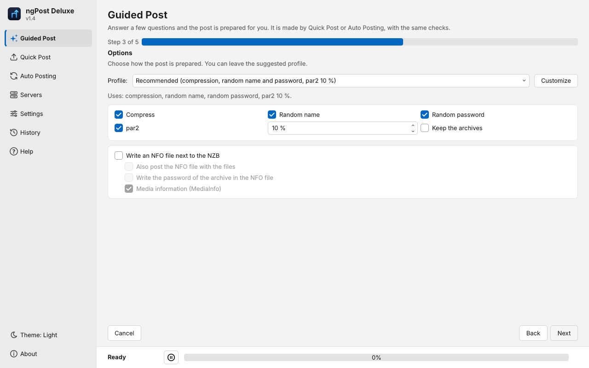
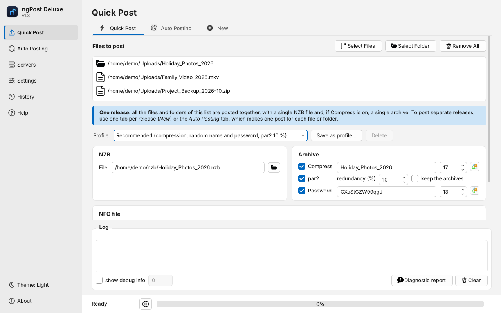
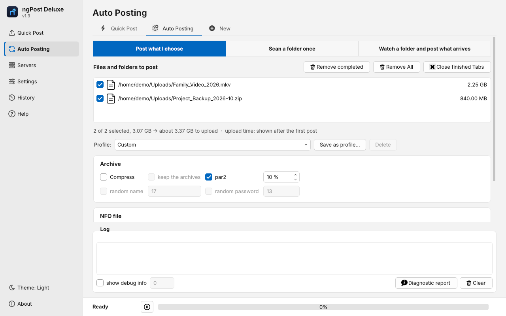
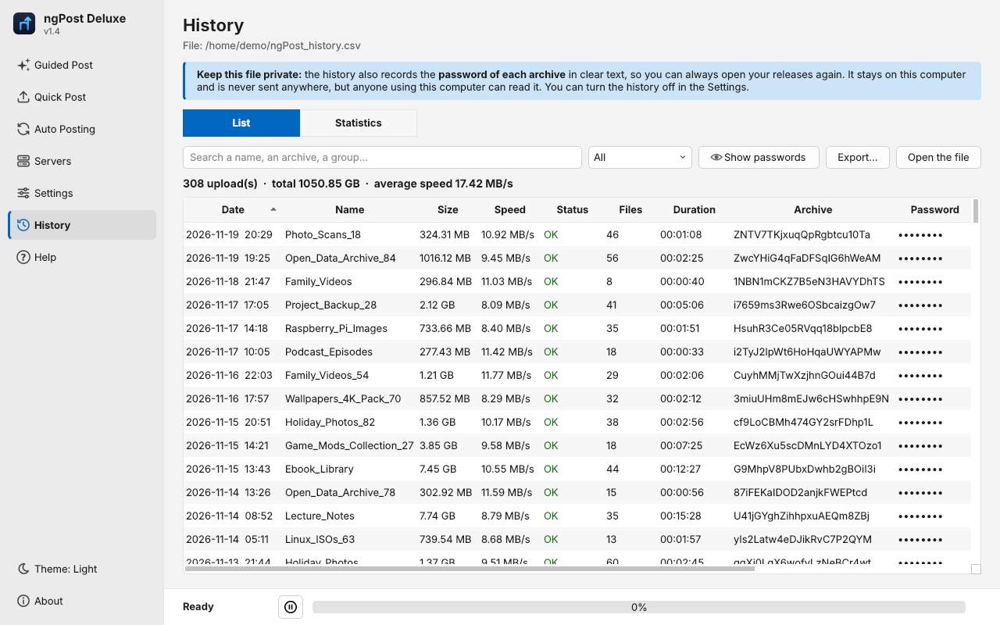
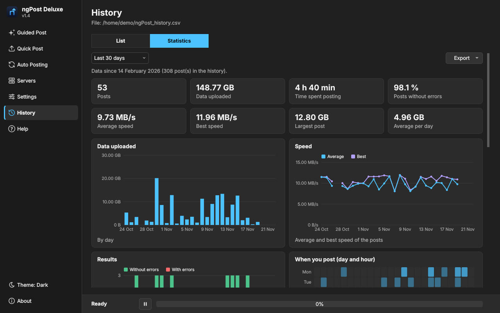
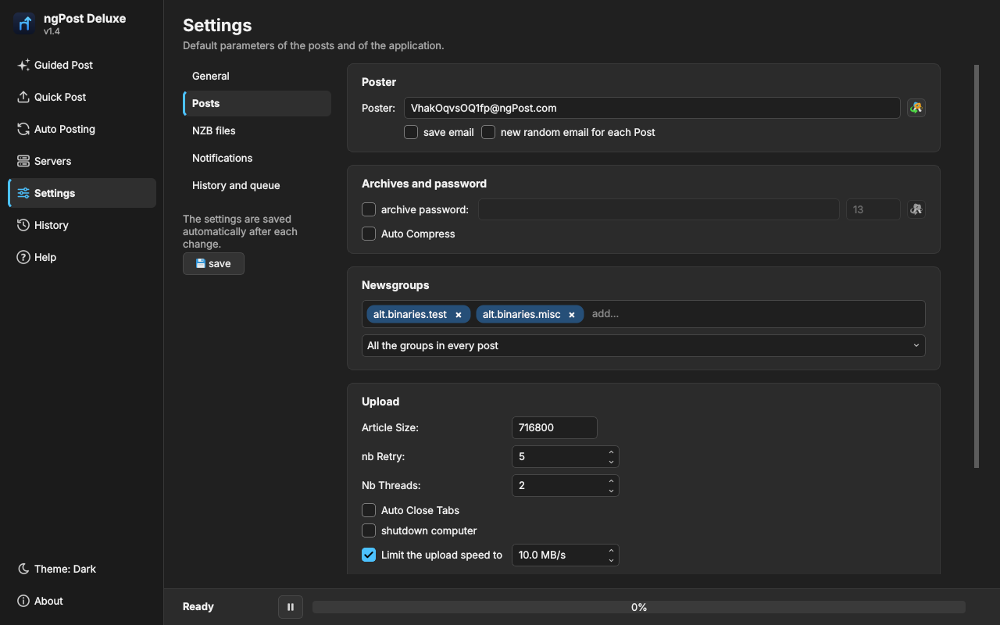
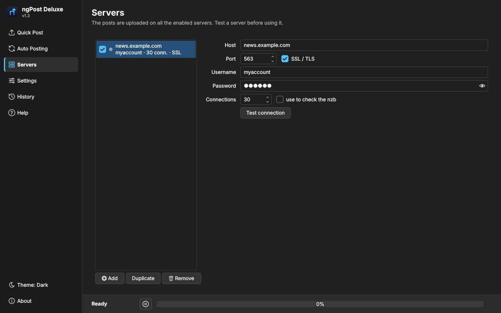

# ngPost Deluxe

**English** | [Français](README_FR.md) | [Deutsch](README_DE.md) | [Italiano](README_IT.md) | [Español](README_ES.md) | [Nederlands](README_NL.md) | [Português](README_PT.md) | [中文](README_ZH.md)

**A fast, free and modern Usenet poster for Windows, Linux and Docker.**<br/>
Compress, add par2, obfuscate and post your files from a clean interface (light and dark themes) or from the command line.

[](https://github.com/thenormal/ngPost-Deluxe/releases/latest)
[](https://github.com/thenormal/ngPost-Deluxe/actions/workflows/build-windows.yml)
[](https://github.com/thenormal/ngPost-Deluxe/actions/workflows/tests.yml)
[](https://github.com/thenormal/ngPost-Deluxe/actions/workflows/docker.yml)


[](LICENSE)

[](https://github.com/thenormal/ngPost-Deluxe/releases/latest)

**ngPost Deluxe** is a revisited and redesigned version of the famous Usenet uploader **ngPost**.<br/>
It is a fork of [mbruel/ngPost](https://github.com/mbruel/ngPost) (v4.16, licence GPL v3). All the credit for the original program goes to its author, Matthieu Bruel.<br/>

### Get started
| Windows installer | Windows portable | Docker / Unraid |
|---|---|---|
| Download `ngPostDeluxe-v…-win64-setup.exe` (or `win32`) from the [Releases](https://github.com/thenormal/ngPost-Deluxe/releases/latest) page. 7-Zip is included. | Unzip `ngPostDeluxe-v…-win64.zip` (or `win32`) anywhere and start `ngPostDeluxe.exe`. The settings are in the `ngPost.conf` next to the program. | Image `ghcr.io/thenormal/ngpost-deluxe` with an Unraid template. See [docker/README.md](docker/README.md). |

> Windows may show "Windows protected your PC" because the installer is not digitally signed: click **More info**, then **Run anyway**.

### Quick start
1. Install and start ngPost Deluxe.
2. Open **Servers**, add your Usenet server and press **Test connection**.
3. Open **Quick Post** and drag your files or folders into the window. To post one release for each file or folder, use **Auto Posting**. The **Recommended** profile is a good start (compression, random name and password, par2 10 %).
4. Press **Post Files**. The NZB file is written in the folder chosen in the Settings, and every upload is listed in **History**.

> New to ngPost Deluxe? Try **Guided Post** in the side bar: it asks a few questions and prepares the post for you.

Already using ngPost? Copy your `ngPost.conf` into `%APPDATA%\ngPost Deluxe` and your servers and settings are there.

### Screenshots

| Guided Post (light theme) | Quick Post (light theme) |
|---|---|
|  |  |
| **Auto Posting (light theme)** | **History** |
|  |  |
| **Statistics (dark theme)** | **Settings (dark theme)** |
|  |  |
| **Servers (dark theme)** |  |
|  |  |

### What is different in this fork

**Easy to use**
-   **Guided Post**: a wizard in the side bar that asks what you want to do (one release, each item, scan a folder, watch a folder), what to post, the options and where, then prepares the post with the same checks as Quick Post and Auto Posting. It remembers your last choices and can start several posts together
-   **One list of the posts**: the page Posts shows all the posts together (state, progress bar, speed graph, size, remaining time, NZB, password, and a log of each post with filters and search). Each post has a priority, can be paused and reordered (buttons, right click, drag and drop), and the queue is kept after a restart. Quick Post is now a form that is empty again after each post
-   **Auto Posting, redesigned**: three clear choices (post what I choose, scan a folder once, watch a folder and post what arrives), a preview of what will be posted with the sizes, the state of the folder watching always visible (folder, posts of the day, pause button), and the choice of what happens to the files afterwards: nothing (default), move them to a "Posted" folder or delete them
-   **Profiles**: a ready "Recommended" profile (compression, random name and password, par2 10 %) and your own profiles, saved from the menu of Quick Post and Auto Posting
-   **Complete profiles**: a profile also keeps the name template (`{name}`, `{date}`, `{time}`, `{n}`), the newsgroups, the servers and the NZB folder. Newsgroups and servers can be chosen for each post, also for the watched folders, and the newsgroups you use most can be marked as favorites
-   **Checks before posting**: a window in plain words with a one-click fix (no server or group, folders without compression, rar / 7z or par2 not found, empty password, NZB folder not writable...)
-   **Remembers your choices**: Quick Post and Auto Posting keep the last options and the selected profile for the next start, and the Post button always stays visible under the scrolling page
-   **First start help**: a bar tells what is missing (server, newsgroup) with a button to the right page; the **Settings** are now in five categories
-   **Newsgroups**: a box with "chips", suggestions and checks, and a menu to choose where the posts go when there are several groups
-   **New interface**: side bar (Quick Post, Auto Posting, Servers, Settings, History), pages with cards, advanced options hidden until needed, a new icon and an empty screen that explains what to do. **Light and dark themes**, or automatic like Windows (`theme` key). Set the environment variable `NGPOST_NO_THEME` to get the native look back
-   **New Servers section**: list of the servers with a status dot and an on/off box, details form (password shown on demand) and a **Test connection** button that checks the login. Editing the servers while posting can no longer crash ngPost

**Informed**
-   **Statistics** (History page, switch List / Statistics): totals and charts for the period you choose (today, 7 days, 30 days, 12 months, all): data posted, speed, results, busiest days and hours, newsgroups, servers, how the posts were started and options used, plus rankings. Export as a PDF document, a web page, a CSV file or PNG images of the charts
-   **History page**: every upload is recorded (`ngPost_history.csv` next to the configuration, or `POST_HISTORY`) with its status, number of files and duration. The page lists them with search, period filter, totals, passwords hidden until asked, copy buttons, export and the folder of the NZB. Be careful: the file contains the archive passwords in clear text
-   **Notifications** when the posts are done or fail: system notification, Discord, Telegram or a webhook, one message at the end or one for each post
-   **More notifications**: email, ntfy, Gotify, Pushover and Slack, next to the system notification, Discord, Telegram and webhook (one message at the end or one for each post, never the passwords)
-   **NFO file** written next to the NZB (optionally posted with the files, with the password if you want) and the media information from MediaInfo: duration, video, audio and subtitles
-   **NFO file in six styles** (Scene, Clean, Box, Elegant, Retro and the old Classic) with a preview in the program, a banner of the program and an option for only ASCII characters
-   **Already posted?** A warning lists the items that are already in the history, with a "Post again" box, instead of one question for each post
-   **Diagnostics**: ngPost records the duration and speed of each phase (compression, par2, upload), the errors and the freezes, and the **Diagnostic report** button saves a report to analyse a problem. Passwords, usernames and file names are masked, nothing is sent anywhere

**Reliable**
-   **Failed Articles**: an Article that fails is tried again on another server and in a second round; the button **Repost missing Articles** posts only the missing ones and fixes the NZB; the original files are kept when Articles failed
-   **Queue**: the posts that are not finished are saved and offered again at the next start (`--resume_queue` on the command line)
-   **Watched folders are remembered**: if the program is closed while Auto Posting watches folders, the next start offers to watch them again
-   **Wrong password**: the post stops, with a clear message, when the server refuses the login on every connection
-   **Clearer problems**: a warning when the temporary folder is synchronized (OneDrive and similar), a message when the source files are slow to read, and a clear error naming a file or folder that was moved before the compression started (7-Zip no longer searches for it on all the drives)

**Fast and in control**
-   **ParPar** (a much faster par2 generator) is shipped for Windows 64bit (v0.4.6, public domain) and used automatically when `parpar.exe` is in the ngPost folder. The 64bit par2cmdline has been removed from the package, the 32bit one is kept for Windows 32bit
-   **Faster compression on Windows**: the output of 7-Zip / rar is now read as it arrives (a 115 MB post waited 200 s before, 1 s now)
-   **Speed limit**: a maximum upload speed in MB/s for all the connections and all the posts together (Settings, Posts, Upload; `--max_speed` on the command line), so the rest of your connection stays usable. It can be changed while posting

**Security**
-   **Security fix**: possible heap overflow in the yEnc encoding buffer (the output could be bigger than the buffer with specific data)
-   **Archive password off the command line**: 7-Zip receives it on its standard input and rar through the `RAR` environment variable, so it is no longer visible in the list of processes

**Packages and languages**
-   **Docker image** of the command line version: it watches a folder and posts everything that arrives in it, with a template for **Unraid** and a guide for use behind a VPN
-   **Windows installer** (64 bit and 32 bit, with **7-Zip included**) and portable ZIP packages, built automatically on GitHub and published in the Releases (`ngPostDeluxe.exe`)
-   **New version notice**: once a day the program asks GitHub for the latest release and shows a "Version X available" button in the side bar (nothing is downloaded; it can be turned off in the Settings)
-   **Help in 8 languages**, a **Feedback** button in the About window (opens a new GitHub issue already filled in) and the notifications in the diagnostic report

**Settings and tools**
-   **Export and import of the settings**: move your settings, profiles, notifications and servers to another computer (Settings, History and queue; `--export_settings` and `--import_settings`). Passwords, tokens and folders of the computer are never in the file
-   **NZB_POST_CMD**: the placeholders can contain spaces (a path like `C:\My folder\file.nzb` stays ONE argument) and the command is started in background (ngPost doesn't wait for it anymore, so its exit code is no longer logged)
-   **RAR_EXTRA and PAR2_ARGS**: parsed respecting the double quotes. 7-Zip is detected from the program name and not from the whole path
-   **Autosave**: every change of the settings is saved automatically (the previous file is kept as `ngPost.conf.bak`)

The Windows installers and portable packages and the Docker image are in the [Releases](https://github.com/thenormal/ngPost-Deluxe/releases/latest). On the other systems, build it from the sources (see below).<br/>

The full list of changes of each version is in the [release notes](https://github.com/thenormal/ngPost-Deluxe/releases) and in the [roadmap](ROADMAP.md).

### Main features
-   **Command line and GUI Usenet poster** for binaries, developed in **C++11/Qt5**, designed to be as fast as possible
-   **compresses** (with your external rar/7zip) and **generates the par2** before posting
-   has a **posting queue** and **packs the next post while uploading the current one**
-   **automates posts**: scans folders, or monitors them, and posts each new file/folder individually (random archive name and password possible)
-   **obfuscates the Article headers**: random poster and UUID subject, the post can only be found with the nzb file
-   **generates the nzb file** and writes a csv **history of the posts** (archive name and password included)
-   can **delete files once posted**, **run a command or script** after each post (NZB_POST_CMD) and **switch off the computer**
-   **profiles** of options, an **NFO file** with the media information (MediaInfo), **checks before posting**, a warning for what is already in the history and **notifications** (system, Discord, Telegram, webhook)
-   **Guided Post** wizard and **Statistics** of your uploads (charts, export as PDF, web page, CSV or PNG)
-   translated in **Chinese, Dutch, English, French, German, Italian, Portuguese and Spanish**

### Configuration keywords changed in this fork
The configuration file works as in the original project (default: **~/.ngPost** on Linux and Mac, **ngPost.conf** in the installation folder on Windows). Only the keywords whose behaviour has changed are listed here:

- **NZB_POST_CMD**: command executed after each post. The placeholders can contain spaces and the command runs in background (its exit code is not logged)
- **RAR_EXTRA**: to customise the rar command (no need to specify 'a', '-idp' or '-r'). Not needed for 7-zip, except to change the compression level. It now respects double quotes.
- **PAR2_PATH**: to change the par2 generator and be able to use [Parpar](https://github.com/animetosho/ParPar) or [Multipar](http://hp.vector.co.jp/authors/VA021385/). (ParPar is used automatically on Windows 64bit if `parpar.exe` is in the ngPost folder; par2cmdline is still the default elsewhere)
- **PAR2_ARGS**: to customise the par2 command, especially if you choose a program different from the default one. It now respects double quotes.
- **theme**: interface theme, `AUTO` (like Windows), `LIGHT` or `DARK`
- **history**: `ON` (default) or `OFF`, history of the uploads shown in the History page. Without **POST_HISTORY** the file is `ngPost_history.csv` next to the configuration. New columns are added at the end of each line: status, number of files, duration and NZB file; from v1.4 also the servers, the options, how the post was started and the exact size
- **move_posted**: folder where Auto Posting moves each file or folder once it is posted (a name like `Posted` is created next to each item, a full path is used as it is); also `--move_posted`
- **warn_duplicates**: `ON` (default) or `OFF`, warns (GUI) or skips (command line) what is already in the history; `--allow_repost` posts it anyway
- **limit_speed** (`ON` / `OFF`) and **max_speed** (MB/s): maximum upload speed for all the connections together, also `--max_speed`; `max_speed` alone turns the limit on (handy with Docker)
- **gen_nfo**, **nfo_in_post**, **nfo_password**, **nfo_media** (`ON` / `OFF`), **mediainfo_path** and **nfo_text**: NFO file written next to the NZB, posted with the files, with the password, with the MediaInfo information; path of MediaInfo; free text added at the end
- **profile**: the profiles of options saved from the GUI, one line for each (better managed from the menu of Quick Post and Auto Posting than by hand)
- **quick_options**, **auto_options**, **quick_profile** and **auto_profile**: the options and the profile of Quick Post and Auto Posting when the program was closed, written by the program itself (no need to edit them)
- **check_updates**: `ON` (default) or `OFF`, once a day the GUI looks for a new version on GitHub (the command line and Docker never do)
- **notify_discord**, **notify_telegram_token**, **notify_telegram_chat**, **notify_webhook** and **notify_when** (`all_done` or `each`): notifications when the posts are done. Treat the addresses and the token like passwords

### How to build
#### Linux
Dependencies (Ubuntu / Debian):
```
sudo apt install build-essential qtbase5-dev qt5-qmake libssl-dev
```
Build the graphical version, or only the command line version (no Qt GUI libraries needed):
```
# GUI
cd src && qmake ngPost.pro && make -j$(nproc)

# command line only, in its own folder
mkdir build-cmd && cd build-cmd && qmake ../src/ngPost_cmd.pro && make -j$(nproc)
```
The executable **ngPost** is created in the folder where you built it: copy it somewhere in your PATH.

#### Windows
Install [Qt 5.15](https://www.qt.io/download) with MinGW, then open `src/ngPost.pro` in Qt Creator, or from a Qt command prompt: `mkdir build && cd build && qmake ../src/ngPost.pro CONFIG+=release && mingw32-make`. The program is called `ngPostDeluxe.exe`. The installer is made with [Inno Setup](https://jrsoftware.org/isinfo.php) (`installer/ngPostDeluxe.iss`); all the steps of the official packages are in `.github/workflows/build-windows.yml`.

#### Docker
Command line version in a container (see [docker/README.md](docker/README.md)):
```
docker build -t ngpost-deluxe .
```

#### Other systems
As it is made in C++/Qt, you can build and run it on any OS (macOS, Android...): the easiest way is to [install Qt](https://www.qt.io/download) and load `src/ngPost.pro` in Qt Creator.

### Full documentation
The command line options, the complete list of configuration keywords and the installation guides are those of the original project: see the [README of ngPost](https://github.com/mbruel/ngPost#readme). Its installation guides refer to the original binaries, not to this fork.

### Roadmap
What is done, what is planned and the ideas under evaluation: see [ROADMAP.md](ROADMAP.md).

### FAQ

**Windows says "Windows protected your PC". Is it safe?**<br/>
The installer is not digitally signed (a signature costs money), so SmartScreen warns about any unknown program. Click **More info**, then **Run anyway**. The program is open source and the packages are built automatically from this repository.

**Where are my settings and my history?**<br/>
With the installer: in `%APPDATA%\ngPost Deluxe` (`ngPost.conf` and `ngPost_history.csv`). With the portable version: `ngPost.conf` next to the program. If there is a `ngPost.conf` next to `ngPostDeluxe.exe`, it is used instead of the one in `%APPDATA%`. The history can be moved with `POST_HISTORY`.

**How do I keep the settings of the original ngPost?**<br/>
Close ngPost Deluxe, copy your old `ngPost.conf` into `%APPDATA%\ngPost Deluxe` and, if it contains a `PAR2_PATH` line pointing to an old folder, delete that line (the program then uses its own ParPar). Your old `ngPost_history.csv` is read too: copy it next to the configuration, or keep the path in `POST_HISTORY`.

**Something does not work (compression, par2, upload…). What can I do?**<br/>
Press **Diagnostic report** in the log and attach the file to an [issue](https://github.com/thenormal/ngPost-Deluxe/issues). Passwords, user names and file names are masked, nothing is sent anywhere.

**Do I have to install 7-Zip or rar?**<br/>
No: 7-Zip is included in the installer and the portable package. You can still choose another 7-Zip or WinRAR in the Settings.

**Is the history private?**<br/>
It contains the archive passwords in clear text: keep `ngPost_history.csv` (and your `ngPost.conf`, which contains your server login) private, and do not attach them to a public issue.

### Licence
[**ngPost**](https://github.com/mbruel/ngPost) is released under the **GPL v3** licence (see [LICENSE](LICENSE)). Copyright (C) 2020 Matthieu Bruel. ngPost Deluxe is a fork maintained by [thenormal](https://github.com/thenormal).

### Questions / Issues / Requests
- for questions about this fork, you can contact its maintainer on GitHub: [thenormal](https://github.com/thenormal)
- for the original program, refer to the [original project](https://github.com/mbruel/ngPost) and its author Matthieu Bruel

### Supported Languages
For now, ngPost is translated in Chinese, Dutch, English, French, German, Italian, Portuguese and Spanish (the Italian translation has been added in this fork).<br/>
If you'd like to translate ngPost in your language, it's easy to do (there is a nice GUI for that: QtLinguist), the translation files are in the **src/lang** folder.

### Thanks
- Matthieu Bruel (mbruel) for having created ngPost and published it under GPL v3
- Uukrull for his intensive testing and feedbacks and for building all the MacOS packages.
- awsms for his testing on proper server with a 10Gb/s connection that helped to improve ngPost's upload speed and the multi-threading support
- animetosho for having developped ParPar, the fasted par2 generator ever!
- demanuel for the dev of NewsUP that was my first poster
- noobcoder1983, tensai then yuppie for the German translation
- tiriclote for the Spanish translation
- hunesco for the Portuguese translation
- Peng for the Chinese translation
- all ngPost users ;)

### Support this fork
ngPost Deluxe is free. If it is useful to you, you can support its development on Ko-fi:<br/>
[](https://ko-fi.com/thenormal)

### Support the original author
ngPost has been created by Matthieu Bruel. If you use the app and would like to contribute to the effort, please do it on the [original project](https://github.com/mbruel/ngPost).
