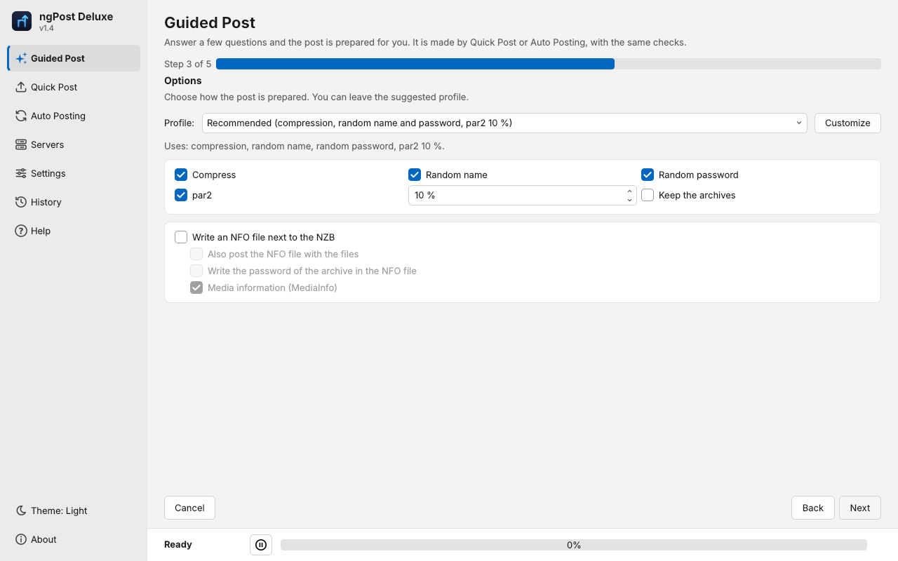
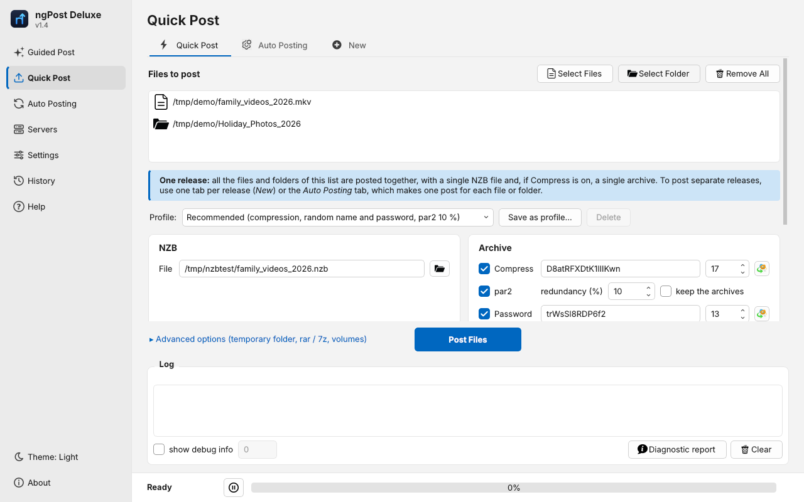
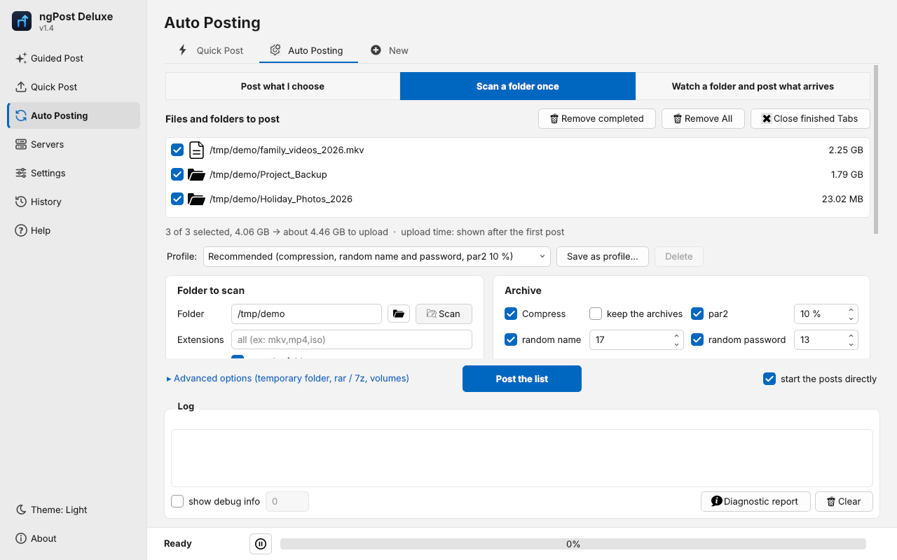
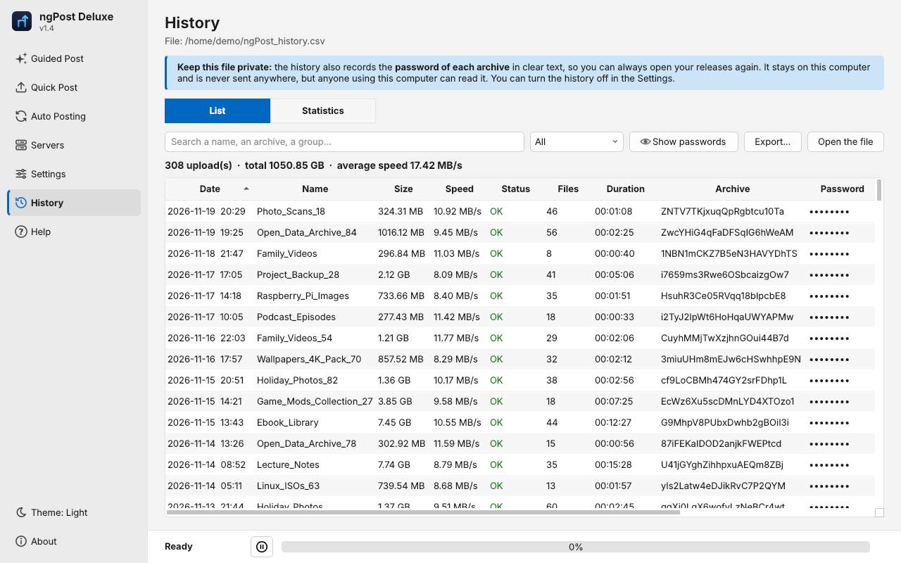
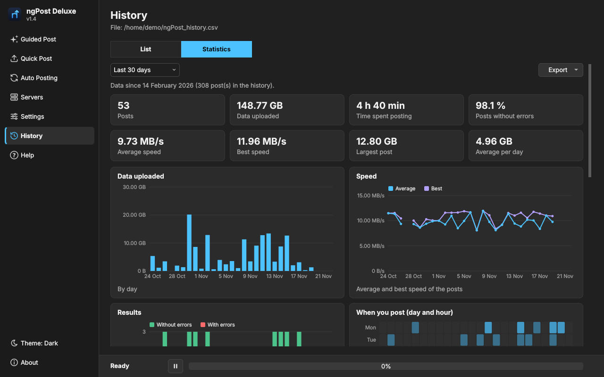
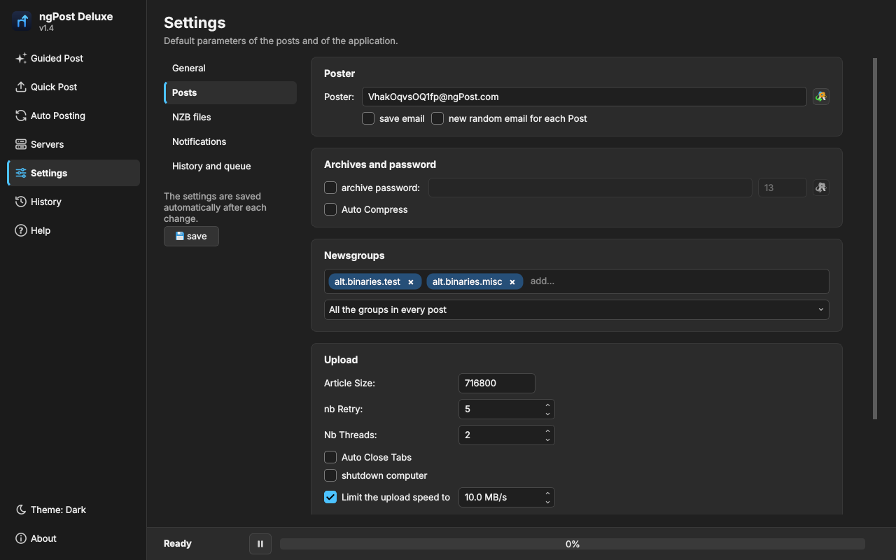
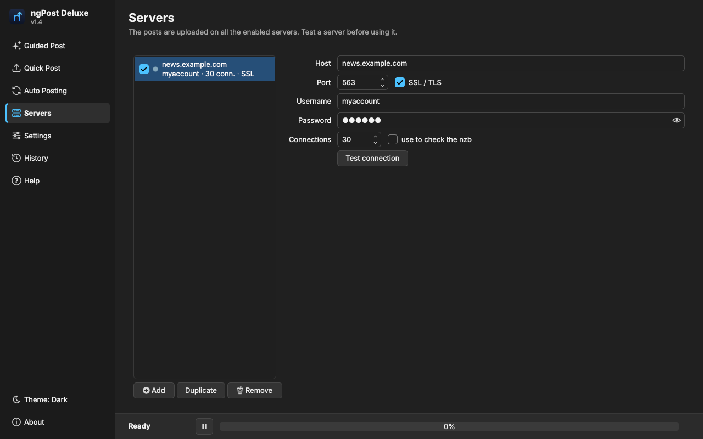

# ngPost Deluxe

[English](README.md) | [Français](README_FR.md) | **Deutsch** | [Italiano](README_IT.md) | [Español](README_ES.md) | [Nederlands](README_NL.md) | [Português](README_PT.md) | [中文](README_ZH.md)

**Ein schneller, kostenloser und moderner Usenet-Poster für Windows, Linux und Docker.**<br/>
Komprimieren, par2 hinzufügen, verschleiern und Dateien posten: über eine übersichtliche Oberfläche (helles und dunkles Design) oder über die Kommandozeile.

[](https://github.com/thenormal/ngPost-Deluxe/releases/latest)
[](https://github.com/thenormal/ngPost-Deluxe/actions/workflows/build-windows.yml)
[](https://github.com/thenormal/ngPost-Deluxe/actions/workflows/tests.yml)
[](https://github.com/thenormal/ngPost-Deluxe/actions/workflows/docker.yml)


[](LICENSE)

[](https://github.com/thenormal/ngPost-Deluxe/releases/latest)

**ngPost Deluxe** ist eine überarbeitete und neu gestaltete Version des bekannten Usenet-Uploaders **ngPost**.<br/>
Es ist ein Fork von [mbruel/ngPost](https://github.com/mbruel/ngPost) (v4.16, Lizenz GPL v3). Das Verdienst für das ursprüngliche Programm gebührt seinem Autor, Matthieu Bruel.<br/>

### Erste Schritte
| Windows-Installer | Windows portabel | Docker / Unraid |
|---|---|---|
| Lade `ngPostDeluxe-v…-win64-setup.exe` (oder `win32`) von der Seite [Releases](https://github.com/thenormal/ngPost-Deluxe/releases/latest) herunter. 7-Zip ist enthalten. | Entpacke `ngPostDeluxe-v…-win64.zip` (oder `win32`) an einen beliebigen Ort und starte `ngPostDeluxe.exe`. Die Einstellungen stehen in der `ngPost.conf` neben dem Programm. | Image `ghcr.io/thenormal/ngpost-deluxe` mit einer Vorlage für Unraid. Siehe [docker/README.md](docker/README.md). |

> Windows zeigt eventuell „Der Computer wurde durch Windows geschützt“, weil der Installer nicht digital signiert ist: Klicke auf **Weitere Informationen**, dann auf **Trotzdem ausführen**.

### Schnellstart
1. Installiere ngPost Deluxe und starte es.
2. Öffne **Servers**, füge deinen Usenet-Server hinzu und drücke **Test connection**.
3. Öffne **Quick Post** und ziehe deine Dateien oder Ordner ins Fenster. Um für jede Datei oder jeden Ordner ein eigenes Release zu posten, nutzen Sie **Auto Posting**. Das Profil **Empfohlen** ist ein guter Anfang (Komprimierung, zufälliger Name und Passwort, par2 10 %).
4. Drücke **Post Files**. Die NZB-Datei wird in den in den Einstellungen gewählten Ordner geschrieben, und jeder Upload erscheint in **History**.

> Neu bei ngPost Deluxe? Probieren Sie **Geführter Post** in der Seitenleiste: Er stellt ein paar Fragen und bereitet den Post für Sie vor.

Du benutzt schon ngPost? Kopiere deine `ngPost.conf` nach `%APPDATA%\ngPost Deluxe`, dann sind deine Server und Einstellungen da.

### Screenshots

| Geführter Post (helles Design) | Quick Post (helles Design) |
|---|---|
|  |  |
| **Auto Posting (helles Design)** | **Verlauf** |
|  |  |
| **Statistik (dunkles Design)** | **Einstellungen (dunkles Design)** |
|  |  |
| **Server (dunkles Design)** |  |
|  |  |

### Was in diesem Fork anders ist

**Einfach zu bedienen**
-   **Geführter Post**: ein Assistent in der Seitenleiste, der fragt, was Sie tun möchten (ein Release, jedes Element, einen Ordner durchsuchen, einen Ordner überwachen), was gepostet wird, die Optionen und wohin, und dann den Post mit denselben Prüfungen wie Quick Post und Auto Posting vorbereitet. Er merkt sich Ihre letzte Auswahl und kann mehrere Posts gemeinsam starten
-   **Auto Posting, neu gestaltet**: drei klare Möglichkeiten (posten, was ich auswähle; einen Ordner einmal durchsuchen; einen Ordner überwachen und posten, was ankommt), Vorschau dessen, was gepostet wird, mit den Größen, der Zustand der Ordnerüberwachung immer sichtbar (Ordner, Posts des Tages, Pause-Schaltfläche) und die Wahl, was danach mit den Dateien geschieht: nichts (Standard), in einen Ordner "Posted" verschieben oder löschen
-   **Profile**: ein fertiges Profil "Empfohlen" (Komprimierung, zufälliger Name und Passwort, par2 10 %) und eigene Profile, gespeichert über das Menü von Quick Post und Auto Posting
-   **Prüfungen vor dem Posten**: ein Fenster in einfachen Worten mit Korrektur per Klick (kein Server oder keine Gruppe, Ordner ohne Komprimierung, rar / 7z oder par2 nicht gefunden, leeres Passwort, NZB-Ordner nicht beschreibbar...)
-   **Merkt sich Ihre Auswahl**: Quick Post und Auto Posting behalten die letzten Optionen und das gewählte Profil für den nächsten Start, und die Schaltfläche Posten bleibt unter der scrollenden Seite immer sichtbar
-   **Hilfe beim ersten Start**: eine Leiste sagt, was fehlt (Server, Newsgroup), mit einer Schaltfläche zur richtigen Seite; die **Einstellungen** sind jetzt in fünf Kategorien
-   **Newsgroups**: ein Feld mit „Chips“, Vorschlägen und Prüfungen sowie ein Menü, um bei mehreren Gruppen zu wählen, wohin die Posts gehen
-   **Neue Oberfläche**: Seitenleiste (Quick Post, Auto Posting, Server, Einstellungen, Verlauf), Seiten mit Karten, erweiterte Optionen ausgeblendet, bis sie gebraucht werden, ein neues Symbol und ein leerer Bildschirm, der erklärt, was zu tun ist. **Helles und dunkles Design** oder automatisch wie Windows (Schlüssel `theme`). Setze die Umgebungsvariable `NGPOST_NO_THEME`, um das native Aussehen zurückzubekommen
-   **Neuer Server-Bereich**: Liste der Server mit Statuspunkt und Ein/Aus-Kästchen, Detailformular (Passwort auf Wunsch sichtbar) und eine Schaltfläche **Verbindung testen**, die die Anmeldung prüft. Das Ändern der Server während eines Uploads kann ngPost nicht mehr abstürzen lassen

**Informiert**
-   **Statistik** (Seite Verlauf, Umschalter Liste / Statistik): Summen und Diagramme für den gewählten Zeitraum (heute, 7 Tage, 30 Tage, 12 Monate, alles): geposteter Datenumfang, Geschwindigkeit, Ergebnisse, aktivste Tage und Uhrzeiten, Newsgroups, Server, Art des Starts der Posts und verwendete Optionen, dazu Ranglisten. Export als PDF-Dokument, Webseite, CSV-Datei oder PNG-Bilder der Diagramme
-   **Seite Verlauf**: jeder Upload wird gespeichert (`ngPost_history.csv` neben der Konfiguration oder `POST_HISTORY`) mit Status, Anzahl der Dateien und Dauer. Die Seite listet sie mit Suche, Zeitraumfilter, Summen, ausgeblendeten Passwörtern, Kopieren, Export und dem Ordner der NZB auf. Achtung: die Datei enthält die Archivpasswörter im Klartext
-   **Benachrichtigungen**, wenn Posts fertig sind oder fehlschlagen: Systembenachrichtigung, Discord, Telegram oder ein Webhook, eine Nachricht am Ende oder eine pro Post
-   **NFO-Datei** neben der NZB-Datei (auf Wunsch mit den Dateien gepostet, auf Wunsch mit Passwort) und Medieninformationen mit MediaInfo: Dauer, Video, Audio und Untertitel
-   **Schon gepostet?** Eine Warnung listet die Einträge auf, die schon im Verlauf stehen, mit einem Kästchen "Erneut posten", statt einer Frage pro Post
-   **Diagnose**: ngPost zeichnet Dauer und Geschwindigkeit jeder Phase (Kompression, par2, Upload), Fehler und Hänger auf, und die Schaltfläche **Diagnosebericht** speichert einen Bericht zur Fehleranalyse. Passwörter, Benutzernamen und Dateinamen werden maskiert, nichts wird versendet

**Zuverlässig**
-   **Fehlgeschlagene Artikel**: ein fehlgeschlagener Artikel wird auf einem anderen Server und in einer zweiten Runde erneut versucht; die Schaltfläche **Repost missing Articles** postet nur die fehlenden und korrigiert die NZB; die Originaldateien bleiben erhalten, wenn Artikel fehlgeschlagen sind
-   **Warteschlange**: nicht beendete Posts werden gespeichert und beim nächsten Start wieder angeboten (`--resume_queue` in der Kommandozeile)
-   **Falsches Passwort**: der Post wird mit einer klaren Meldung gestoppt, wenn der Server den Login auf allen Verbindungen ablehnt
-   **Klarere Probleme**: eine Warnung bei synchronisiertem temporärem Ordner (OneDrive und ähnliche), eine Meldung, wenn die Quelldateien langsam gelesen werden, und ein klarer Fehler mit dem Namen einer Datei oder eines Ordners, die vor der Komprimierung verschoben wurden (7-Zip sucht sie nicht mehr auf allen Laufwerken)

**Schnell und unter Kontrolle**
-   **ParPar** (ein viel schnellerer par2-Generator) wird für Windows 64bit mitgeliefert (v0.4.6, gemeinfrei) und automatisch verwendet, wenn sich `parpar.exe` im ngPost-Ordner befindet. Das 64bit-par2cmdline wurde aus dem Paket entfernt, das 32bit-Programm bleibt für Windows 32bit erhalten
-   **Schnellere Komprimierung unter Windows**: die Ausgabe von 7-Zip / rar wird jetzt laufend gelesen (ein Post mit 115 MB wartete vorher 200 s, jetzt 1 s)
-   **Geschwindigkeitsbegrenzung**: eine maximale Upload-Geschwindigkeit in MB/s für alle Verbindungen und alle Posts zusammen (Einstellungen, Posts, Upload; `--max_speed` in der Befehlszeile), damit der Rest Ihrer Internetverbindung nutzbar bleibt. Kann während des Postens geändert werden

**Sicherheit**
-   **Sicherheitskorrektur**: möglicher Heap-Überlauf im yEnc-Kodierungspuffer (die Ausgabe konnte bei bestimmten Daten größer als der Puffer sein)
-   **Archiv-Passwort nicht mehr in der Kommandozeile**: 7-Zip erhält es über die Standardeingabe und rar über die Umgebungsvariable `RAR`, es ist also nicht mehr in der Prozessliste sichtbar

**Pakete und Sprachen**
-   **Docker-Image** der Kommandozeilenversion: sie überwacht einen Ordner und postet alles, was darin ankommt, mit einer Vorlage für **Unraid** und einer Anleitung für den Betrieb hinter einem VPN
-   **Windows-Installer** (64 Bit und 32 Bit, **7-Zip inklusive**) und portable ZIP-Pakete, automatisch auf GitHub erstellt und in den Releases veröffentlicht (`ngPostDeluxe.exe`)
-   **Hinweis auf neue Version**: einmal am Tag fragt das Programm GitHub nach der neuesten Version und zeigt in der Seitenleiste eine Schaltfläche "Version X verfügbar" (es wird nichts heruntergeladen; in den Einstellungen abschaltbar)
-   **Hilfe in 8 Sprachen**, eine **Feedback**-Schaltfläche im Über-Fenster (öffnet ein neues, schon ausgefülltes GitHub-Issue) und die Benachrichtigungen im Diagnosebericht

**Einstellungen und Werkzeuge**
-   **NZB_POST_CMD**: die Platzhalter dürfen Leerzeichen enthalten (ein Pfad wie `C:\Meine Ordner\datei.nzb` bleibt EIN Argument) und der Befehl wird im Hintergrund gestartet (ngPost wartet nicht mehr darauf, daher wird sein Exit-Code nicht mehr protokolliert)
-   **RAR_EXTRA und PAR2_ARGS**: werden unter Beachtung der Anführungszeichen ausgewertet. 7-Zip wird am Programmnamen erkannt und nicht am gesamten Pfad
-   **Automatisches Speichern**: jede Änderung der Einstellungen wird automatisch gespeichert (die vorherige Datei bleibt als `ngPost.conf.bak` erhalten)

Die Windows-Installer, die portablen Pakete und das Docker-Image findest du unter [Releases](https://github.com/thenormal/ngPost-Deluxe/releases/latest). Auf anderen Systemen aus den Quellen bauen (siehe unten).<br/>

Die vollständige Liste der Änderungen jeder Version steht in den [Release-Notes](https://github.com/thenormal/ngPost-Deluxe/releases) und in der [Roadmap](ROADMAP.md).

### Hauptfunktionen
-   **Usenet-Poster für die Kommandozeile und mit schicker GUI** für Binärdateien, entwickelt in **C++11/Qt5**
-   er ist darauf ausgelegt, **so schnell wie möglich** zu sein und ALLE wichtigen Funktionen zu bieten, **um Daten einfach und sicher zu posten**.
-   er kann **komprimieren** (mit deinem externen rar-Programm) und vor dem Posten **die par2-Dateien erzeugen**!
-   er hat eine **Warteschlange**, um mehrere Posts vorzubereiten (besonders in der GUI mit Tabs).
-   er **packt den nächsten Post, während der aktuelle hochgeladen wird** (Komprimierung + par2-Erzeugung)
-   er kann Posts **automatisieren**, indem er **Ordner scannt** und jede Datei/jeden Ordner einzeln postet, nachdem sie komprimiert (mit eventuell zufälligem Archivnamen und Passwort) und die par2 erzeugt wurden!
-   er kann **Ordner überwachen und jede neue Datei/jeden neuen Ordner** einzeln posten, nachdem sie komprimiert wurden.
-   er kann **Dateien/Ordner nach dem Posten automatisch löschen** (nur beim Überwachen in der GUI und mit --auto und --monitor in der Kommandozeile)
-   er kann nach jedem Post **einen BEFEHL oder ein Skript ausführen** (siehe NZB_POST_CMD in der Konfigurationsdatei)
-   er kann **den Computer ausschalten**, wenn alle Posts fertig sind
-   **Profile** mit Optionen, **NFO-Datei** mit den Medieninformationen (MediaInfo), **Prüfungen vor dem Posten**, Warnung für das, was schon im Verlauf steht, und **Benachrichtigungen** (System, Discord, Telegram, Webhook)
-   Assistent **Geführter Post** und **Statistik** Ihrer Uploads (Diagramme, Export als PDF, Webseite, CSV oder PNG)
-   er ist **übersetzt in Chinesisch, Niederländisch, Englisch, Französisch, Deutsch, Italienisch, Portugiesisch und Spanisch**.

### In diesem Fork geänderte Konfigurations-Schlüsselwörter
Die Konfigurationsdatei funktioniert wie im Originalprojekt (Standard: **~/.ngPost** unter Linux und Mac, **ngPost.conf** im Installationsordner unter Windows). Hier sind nur die Schlüsselwörter aufgeführt, deren Verhalten sich geändert hat:

- **NZB_POST_CMD**: Befehl, der nach jedem Post ausgeführt wird. Die Platzhalter dürfen Leerzeichen enthalten und der Befehl läuft im Hintergrund (sein Exitcode wird nicht protokolliert)
- **RAR_EXTRA**: um den rar-Befehl anzupassen (das 'a', '-idp' oder '-r' musst du nicht angeben). Für 7-zip nicht nötig, außer du willst die Kompressionsstufe ändern.
- **PAR2_PATH**: um den par2-Generator zu ändern und [Parpar](https://github.com/animetosho/ParPar) oder [Multipar](http://hp.vector.co.jp/authors/VA021385/) zu verwenden. (par2cmdline ist der mitgelieferte Standardgenerator, ParPar wird unter Windows 64bit automatisch verwendet, wenn `parpar.exe` im ngPost-Ordner liegt)
- **PAR2_ARGS**: um den par2-Befehl anzupassen, besonders wenn du ein anderes Programm als das Standard-par2cmdline wählst
- **theme**: Design der Oberfläche, `AUTO` (wie Windows), `LIGHT` oder `DARK`
- **history**: `ON` (Standard) oder `OFF`, Verlauf der Uploads auf der Seite Verlauf. Ohne **POST_HISTORY** ist die Datei `ngPost_history.csv` neben der Konfiguration. Am Ende jeder Zeile kommen neue Spalten hinzu: Status, Anzahl der Dateien, Dauer und NZB-Datei; ab v1.4 außerdem die Server, die Optionen, die Art des Starts und die genaue Größe
- **move_posted**: Ordner, in den Auto Posting jede Datei oder jeden Ordner nach dem Posten verschiebt (neben jedem Eintrag wird ein Ordner mit einem Namen wie `Posted` angelegt, ein vollständiger Pfad wird unverändert benutzt); auch `--move_posted`
- **warn_duplicates**: `ON` (Standard) oder `OFF`, warnt (GUI) oder überspringt (Kommandozeile), was schon im Verlauf steht; `--allow_repost` postet es trotzdem
- **limit_speed** (`ON` / `OFF`) und **max_speed** (MB/s): maximale Upload-Geschwindigkeit für alle Verbindungen zusammen, auch `--max_speed`; `max_speed` allein schaltet die Begrenzung ein (praktisch mit Docker)
- **gen_nfo**, **nfo_in_post**, **nfo_password**, **nfo_media** (`ON` / `OFF`), **mediainfo_path** und **nfo_text**: NFO-Datei neben der NZB-Datei, mit den Dateien gepostet, mit dem Passwort, mit den MediaInfo-Informationen; Pfad von MediaInfo; freier Text am Ende
- **profile**: die in der GUI gespeicherten Options-Profile, eine Zeile pro Profil (besser über das Menü von Quick Post und Auto Posting verwalten als von Hand)
- **quick_options**, **auto_options**, **quick_profile** und **auto_profile**: die Optionen und das Profil von Quick Post und Auto Posting beim Beenden des Programms, vom Programm selbst geschrieben (nicht zu bearbeiten)
- **check_updates**: `ON` (Standard) oder `OFF`, einmal am Tag sucht die Oberfläche auf GitHub nach einer neuen Version (Kommandozeile und Docker tun das nie)
- **notify_discord**, **notify_telegram_token**, **notify_telegram_chat**, **notify_webhook** und **notify_when** (`all_done` oder `each`): Benachrichtigungen, wenn die Posts fertig sind. Behandeln Sie die Adressen und das Token wie Passwörter

### Kompilieren
#### Linux
Abhängigkeiten (Ubuntu / Debian):
```
sudo apt install build-essential qtbase5-dev qt5-qmake libssl-dev
```
Die grafische Version bauen, oder nur die Kommandozeilenversion (die Qt-GUI-Bibliotheken werden nicht benötigt):
```
# GUI
cd src && qmake ngPost.pro && make -j$(nproc)

# command line only, in its own folder
mkdir build-cmd && cd build-cmd && qmake ../src/ngPost_cmd.pro && make -j$(nproc)
```
Die ausführbare Datei **ngPost** liegt danach im Ordner, in dem du gebaut hast: kopiere sie in einen Ordner deines PATH.

#### Windows
Installiere [Qt 5.15](https://www.qt.io/download) mit MinGW und öffne `src/ngPost.pro` in Qt Creator, oder in einer Qt-Eingabeaufforderung: `mkdir build && cd build && qmake ../src/ngPost.pro CONFIG+=release && mingw32-make`. Das Programm heißt `ngPostDeluxe.exe`. Der Installer wird mit [Inno Setup](https://jrsoftware.org/isinfo.php) erstellt (`installer/ngPostDeluxe.iss`); alle Schritte der offiziellen Pakete stehen in `.github/workflows/build-windows.yml`.

#### Docker
Kommandozeilenversion in einem Container (siehe [docker/README.md](docker/README.md)):
```
docker build -t ngpost-deluxe .
```

#### Andere Systeme
Da es in C++/Qt geschrieben ist, kann es auf jedem System (macOS, Android...) gebaut und ausgeführt werden: am einfachsten [installierst du Qt](https://www.qt.io/download) und lädst `src/ngPost.pro` in Qt Creator.

### Vollständige Dokumentation
Die Kommandozeilenoptionen, die vollständige Liste der Konfigurations-Schlüsselwörter und die Installationsanleitungen entsprechen dem Originalprojekt: siehe die [README von ngPost](https://github.com/mbruel/ngPost#readme). Die dortigen Installationsanleitungen beziehen sich auf die Original-Binärdateien, nicht auf diesen Fork.

### FAQ

**Windows meldet „Der Computer wurde durch Windows geschützt“. Ist das sicher?**<br/>
Der Installer ist nicht digital signiert (eine Signatur kostet Geld), deshalb warnt SmartScreen vor jedem unbekannten Programm. Klicke auf **Weitere Informationen** und dann auf **Trotzdem ausführen**. Das Programm ist Open Source, und die Pakete werden automatisch aus diesem Repository gebaut.

**Wo sind meine Einstellungen und mein Verlauf?**<br/>
Mit dem Installer: in `%APPDATA%\ngPost Deluxe` (`ngPost.conf` und `ngPost_history.csv`). Mit der portablen Version: `ngPost.conf` neben dem Programm. Liegt eine `ngPost.conf` neben `ngPostDeluxe.exe`, wird sie statt der in `%APPDATA%` verwendet. Der Verlauf lässt sich mit `POST_HISTORY` verschieben.

**Wie behalte ich die Einstellungen des originalen ngPost?**<br/>
Schließe ngPost Deluxe, kopiere deine alte `ngPost.conf` nach `%APPDATA%\ngPost Deluxe` und lösche, falls sie eine `PAR2_PATH`-Zeile mit einem alten Ordner enthält, diese Zeile (das Programm nutzt dann sein eigenes ParPar). Auch deine alte `ngPost_history.csv` wird gelesen: kopiere sie neben die Konfiguration oder behalte den Pfad in `POST_HISTORY`.

**Etwas funktioniert nicht (Komprimierung, par2, Upload…). Was kann ich tun?**<br/>
Drücke im Log auf **Diagnostic report** und hänge die Datei an ein [Issue](https://github.com/thenormal/ngPost-Deluxe/issues). Passwörter, Benutzernamen und Dateinamen sind maskiert, es wird nichts gesendet.

**Muss ich 7-Zip oder rar installieren?**<br/>
Nein: 7-Zip ist im Installer und im portablen Paket enthalten. In den Einstellungen kannst du trotzdem ein anderes 7-Zip oder WinRAR wählen.

**Ist der Verlauf privat?**<br/>
Er enthält die Archivpasswörter im Klartext: halte `ngPost_history.csv` und `ngPost.conf` (mit deinem Server-Login) privat und hänge sie nicht an ein öffentliches Issue.

### Lizenz
[**ngPost**](https://github.com/mbruel/ngPost) steht unter der **GPL v3**-Lizenz (siehe [LICENSE](LICENSE)). Copyright (C) 2020 Matthieu Bruel. ngPost Deluxe ist ein Fork, der von [thenormal](https://github.com/thenormal) betreut wird.

### Fragen / Probleme / Wünsche
- bei Fragen zu diesem Fork kannst du dich auf GitHub an den Betreuer wenden: [thenormal](https://github.com/thenormal)
- für das originale Programm wende dich bitte an das [Originalprojekt](https://github.com/mbruel/ngPost) und seinen Autor Matthieu Bruel

### Unterstützte Sprachen
Derzeit ist ngPost in Chinesisch, Niederländisch, Englisch, Französisch, Deutsch, Italienisch, Portugiesisch und Spanisch übersetzt (die italienische Übersetzung stammt aus diesem Fork).<br/>
Wenn du ngPost in deine Sprache übersetzen möchtest, ist das einfach (es gibt dafür eine praktische GUI: QtLinguist). Die Übersetzungsdateien liegen im Ordner **src/lang**.

### Danksagung
- Matthieu Bruel (mbruel), der ngPost geschaffen und unter GPL v3 veröffentlicht hat
- Uukrull für seine intensiven Tests und Rückmeldungen und dafür, dass er alle MacOS-Pakete gebaut hat.
- awsms für seine Tests auf einem richtigen Server mit 10-Gb/s-Anbindung, die geholfen haben, ngPosts Upload-Geschwindigkeit und die Multi-Threading-Unterstützung zu verbessern
- animetosho für die Entwicklung von ParPar, dem schnellsten par2-Generator überhaupt!
- demanuel für die Entwicklung von NewsUP, das mein erster Poster war
- noobcoder1983, tensai und dann yuppie für die deutsche Übersetzung
- tiriclote für die spanische Übersetzung
- hunesco für die portugiesische Übersetzung
- Peng für die chinesische Übersetzung
- alle ngPost-Nutzer ;)

### Diesen Fork unterstützen
ngPost Deluxe ist kostenlos. Wenn es dir nützt, kannst du die Entwicklung auf Ko-fi unterstützen:<br/>
[](https://ko-fi.com/thenormal)

### Den ursprünglichen Autor unterstützen
ngPost wurde von Matthieu Bruel geschaffen. Wenn du die App nutzt und zur Weiterentwicklung beitragen möchtest, tu das bitte beim [Originalprojekt](https://github.com/mbruel/ngPost).
