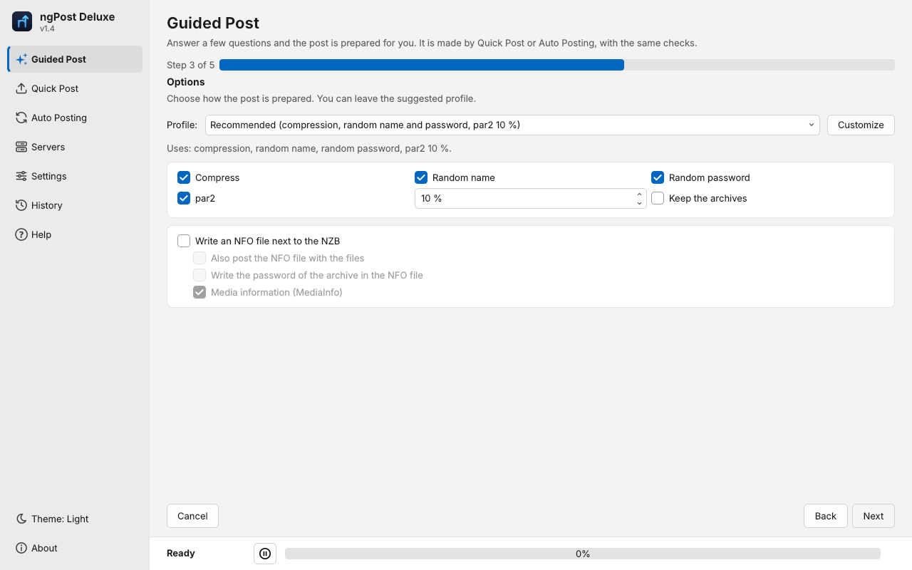
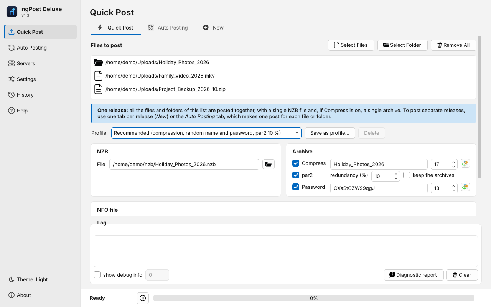
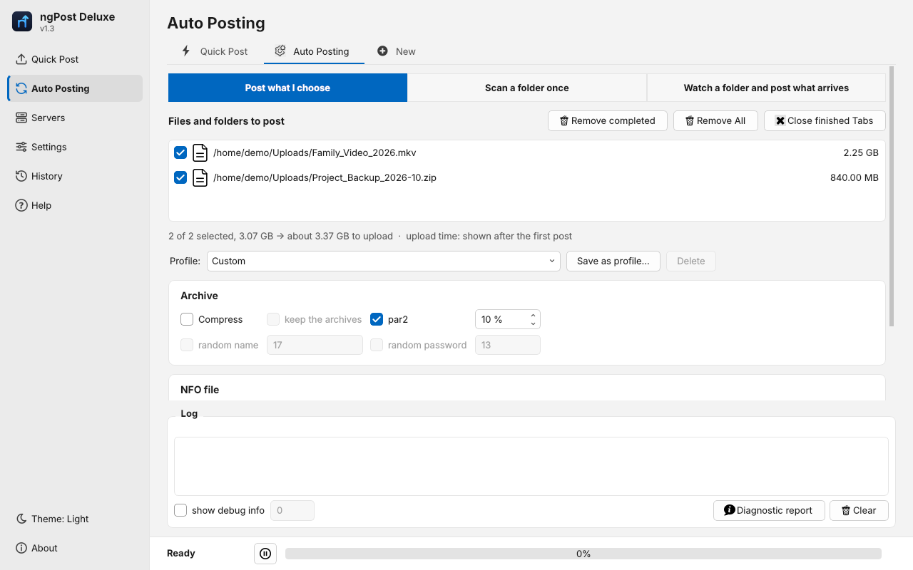
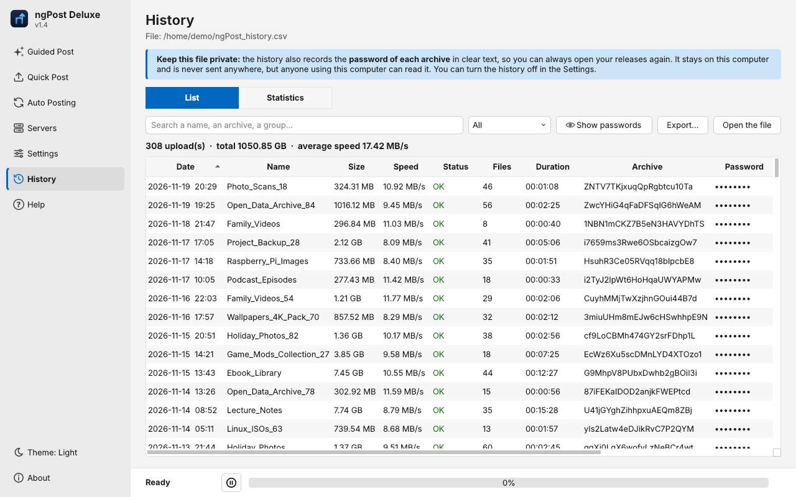
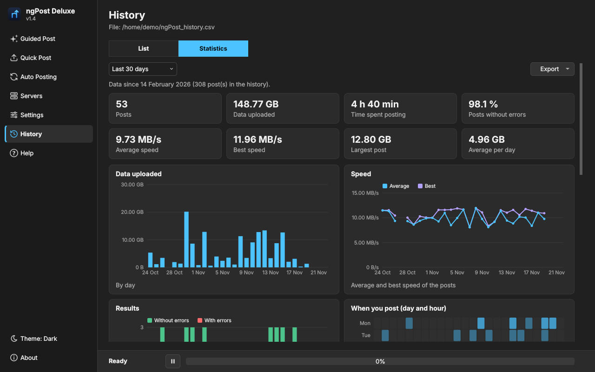
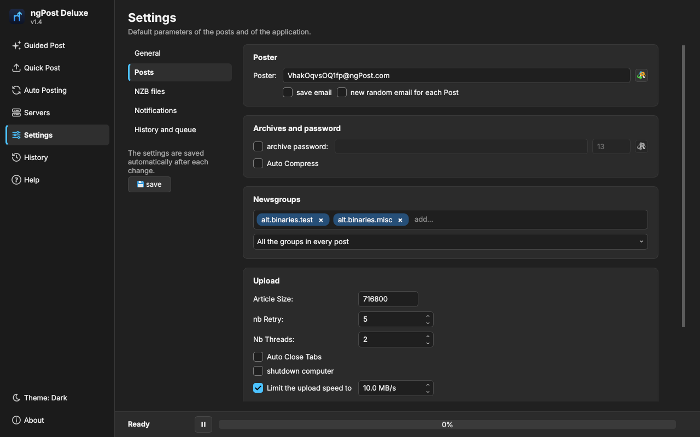
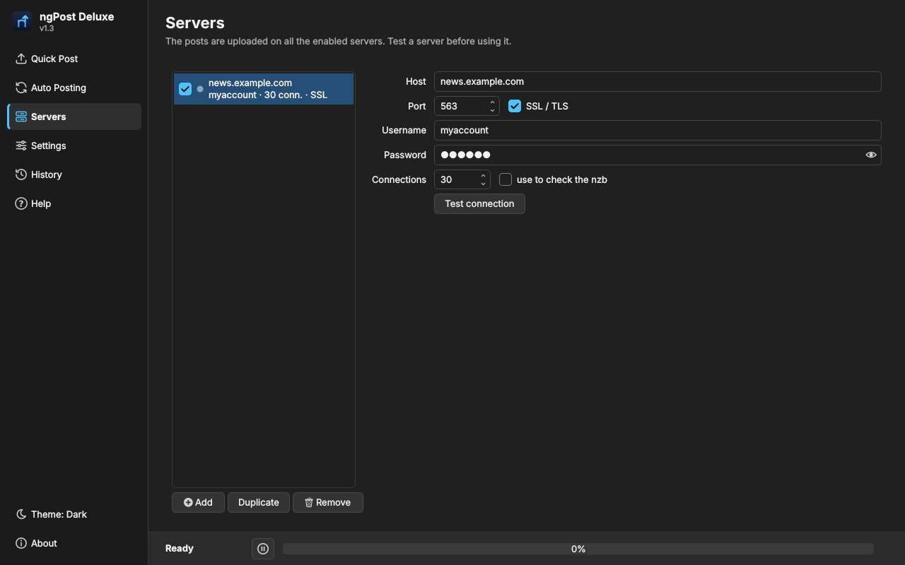

# ngPost Deluxe

[English](README.md) | **Français** | [Deutsch](README_DE.md) | [Italiano](README_IT.md) | [Español](README_ES.md) | [Nederlands](README_NL.md) | [Português](README_PT.md) | [中文](README_ZH.md)

**Un poster Usenet rapide, gratuit et moderne pour Windows, Linux et Docker.**<br/>
Compressez, ajoutez les par2, obfusquez et postez vos fichiers depuis une interface claire (thèmes clair et sombre) ou en ligne de commande.

[](https://github.com/thenormal/ngPost-Deluxe/releases/latest)
[](https://github.com/thenormal/ngPost-Deluxe/releases)
[](https://github.com/thenormal/ngPost-Deluxe/actions/workflows/build-windows.yml)
[](https://github.com/thenormal/ngPost-Deluxe/actions/workflows/tests.yml)
[](https://github.com/thenormal/ngPost-Deluxe/actions/workflows/docker.yml)


[](LICENSE)

[](https://github.com/thenormal/ngPost-Deluxe/releases/latest)

**ngPost Deluxe** est une version revisitée et redessinée du célèbre uploader Usenet **ngPost**.<br/>
C'est un fork de [mbruel/ngPost](https://github.com/mbruel/ngPost) (v4.16, licence GPL v3). Tout le mérite du programme original revient à son auteur, Matthieu Bruel.<br/>

### Pour commencer
| Installateur Windows | Windows portable | Docker / Unraid |
|---|---|---|
| Téléchargez `ngPostDeluxe-v…-win64-setup.exe` (ou `win32`) depuis la page [Releases](https://github.com/thenormal/ngPost-Deluxe/releases/latest). 7-Zip est inclus. | Décompressez `ngPostDeluxe-v…-win64.zip` (ou `win32`) où vous voulez et lancez `ngPostDeluxe.exe`. Les réglages sont dans le `ngPost.conf` à côté du programme. | Image `ghcr.io/thenormal/ngpost-deluxe` avec un modèle pour Unraid. Voir [docker/README.md](docker/README.md). |

> Windows peut afficher « Windows a protégé votre ordinateur » car l'installateur n'est pas signé numériquement : cliquez sur **Informations complémentaires**, puis **Exécuter quand même**.

### Démarrage rapide
1. Installez et lancez ngPost Deluxe.
2. Ouvrez **Servers**, ajoutez votre serveur Usenet et appuyez sur **Test connection**.
3. Ouvrez **Quick Post** et glissez vos fichiers ou dossiers dans la fenêtre. Pour poster une release par fichier ou dossier, utilisez **Post Auto**. Le profil **Recommandé** est un bon départ (compression, nom et mot de passe aléatoires, par2 10 %).
4. Appuyez sur **Post Files**. Le fichier NZB est écrit dans le dossier choisi dans les réglages, et chaque envoi apparaît dans **History**.

> Première fois avec ngPost Deluxe ? Essayez **Post guidé** dans la barre latérale : il pose quelques questions et prépare le post pour vous.

Vous utilisez déjà ngPost ? Copiez votre `ngPost.conf` dans `%APPDATA%\ngPost Deluxe` et vos serveurs et réglages sont repris.

### Captures d'écran

| Post guidé (thème clair) | Quick Post (thème clair) |
|---|---|
|  |  |
| **Post Auto (thème clair)** | **Historique** |
|  |  |
| **Statistiques (thème sombre)** | **Paramètres (thème sombre)** |
|  |  |
| **Serveurs (thème sombre)** |  |
|  |  |

### Ce qui change dans ce fork

**Facile à utiliser**
-   **Post guidé** : un assistant dans la barre latérale qui demande ce que vous voulez faire (une release, chaque élément, analyser un dossier, surveiller un dossier), quoi poster, les options et où, puis prépare le post avec les mêmes vérifications que Quick Post et Post Auto. Il se souvient de vos derniers choix et peut démarrer plusieurs posts ensemble
-   **Post Auto, redessiné** : trois choix clairs (poster ce que je choisis, scanner un dossier une fois, surveiller un dossier et poster ce qui arrive), aperçu de ce qui sera posté avec les tailles, état de la surveillance du dossier toujours visible (dossier, posts du jour, bouton pause) et choix de ce qui arrive aux fichiers ensuite : rien (par défaut), les déplacer dans un dossier « Posted » ou les supprimer
-   **Profils** : un profil « Recommandé » prêt à l'emploi (compression, nom et mot de passe aléatoires, par2 10 %) et vos propres profils, enregistrés depuis le menu de Quick Post et de Post Auto
-   **Vérifications avant d'envoyer** : une fenêtre en mots simples avec la correction en un clic (aucun serveur ou groupe, dossiers sans compression, rar / 7z ou par2 introuvables, mot de passe vide, dossier NZB non modifiable...)
-   **Se souvient de vos choix** : Quick Post et Auto Posting gardent les dernières options et le profil choisi pour le prochain démarrage, et le bouton Poster reste toujours visible sous la page défilante
-   **Aide au premier démarrage** : une barre indique ce qui manque (serveur, newsgroup) avec un bouton vers la bonne page ; les **Paramètres** sont maintenant en cinq catégories
-   **Newsgroups** : une zone avec des « chips », des suggestions et des vérifications, et un menu pour choisir où vont les envois quand il y a plusieurs groupes
-   **Nouvelle interface** : barre latérale (Quick Post, Post Auto, Serveurs, Paramètres, Historique), pages en cartes, options avancées masquées tant qu'elles ne servent pas, une nouvelle icône et un écran vide qui explique quoi faire. **Thèmes clair et sombre**, ou automatique comme Windows (clé `theme`). Définissez la variable d'environnement `NGPOST_NO_THEME` pour retrouver l'apparence native
-   **Nouvelle section Serveurs** : liste des serveurs avec un voyant d'état et une case activé/désactivé, fiche de détail (mot de passe affiché à la demande) et un bouton **Tester la connexion** qui vérifie l'identification. Modifier les serveurs pendant un envoi ne peut plus faire planter ngPost

**Informé**
-   **Statistiques** (page Historique, bascule Liste / Statistiques) : totaux et graphiques pour la période choisie (aujourd'hui, 7 jours, 30 jours, 12 mois, tout) : données postées, vitesse, résultats, jours et heures les plus actifs, newsgroups, serveurs, façon dont les posts ont été lancés et options utilisées, plus des classements. Export en document PDF, page web, fichier CSV ou images PNG des graphiques
-   **Page Historique** : chaque upload est enregistré (`ngPost_history.csv` à côté de la configuration, ou `POST_HISTORY`) avec son statut, le nombre de fichiers et la durée. La page les liste avec recherche, filtre par période, totaux, mots de passe masqués jusqu'à la demande, copie, export et dossier du NZB. Attention : le fichier contient les mots de passe des archives en clair
-   **Notifications** quand les posts sont terminés ou échouent : notification système, Discord, Telegram ou un webhook, un message à la fin ou un pour chaque post
-   **Fichier NFO** écrit à côté du NZB (posté avec les fichiers si vous le voulez, avec le mot de passe si vous le voulez) et informations sur la vidéo avec MediaInfo : durée, vidéo, audio et sous-titres
-   **Déjà posté ?** Un avertissement liste les éléments déjà présents dans l'historique, avec une case « Reposter », au lieu d'une question par post
-   **Diagnostic** : ngPost enregistre la durée et la vitesse de chaque phase (compression, par2, envoi), les erreurs et les blocages, et le bouton **Rapport de diagnostic** enregistre un rapport pour analyser un problème. Mots de passe, identifiants et noms de fichiers sont masqués, rien n'est envoyé

**Fiable**
-   **Articles en échec** : un Article qui échoue est retenté sur un autre serveur et lors d'un second tour ; le bouton **Repost missing Articles** reposte uniquement les Articles manquants et corrige le NZB ; les fichiers d'origine sont conservés quand des Articles ont échoué
-   **File d'attente** : les envois non terminés sont enregistrés et proposés à nouveau au prochain démarrage (`--resume_queue` en ligne de commande)
-   **Mauvais mot de passe** : l'envoi s'arrête, avec un message clair, quand le serveur refuse la connexion sur toutes les connexions
-   **Problèmes plus clairs** : un avertissement quand le dossier temporaire est synchronisé (OneDrive et similaires), un message quand les fichiers source sont lents à lire et une erreur claire indiquant le fichier ou le dossier déplacé avant la compression (7-Zip ne le cherche plus sur tous les disques)

**Rapide et maîtrisé**
-   **ParPar** (un générateur de par2 bien plus rapide) est fourni pour Windows 64bit (v0.4.6, domaine public) et utilisé automatiquement quand `parpar.exe` est dans le dossier de ngPost. par2cmdline 64bit a été retiré du package, la version 32bit est conservée pour Windows 32bit
-   **Compression plus rapide sous Windows** : la sortie de 7-Zip / rar est maintenant lue au fur et à mesure (un post de 115 Mo attendait 200 s avant, 1 s maintenant)
-   **Limite de vitesse** : une vitesse d'envoi maximale en Mo/s pour toutes les connexions et tous les posts ensemble (Paramètres, Envois, Upload ; `--max_speed` en ligne de commande), pour que le reste de votre connexion reste utilisable. Modifiable pendant l'envoi

**Sécurité**
-   **Correctif de sécurité**: dépassement de mémoire possible dans le tampon d'encodage yEnc (la sortie pouvait être plus grande que le tampon avec certaines données)
-   **Mot de passe de l'archive hors de la ligne de commande** : 7-Zip le reçoit sur son entrée standard et rar par la variable d'environnement `RAR`, il n'apparaît donc plus dans la liste des processus

**Paquets et langues**
-   **Image Docker** de la version en ligne de commande : elle surveille un dossier et poste tout ce qui y arrive, avec un modèle pour **Unraid** et un guide pour l'utiliser derrière un VPN
-   **Installateur Windows** (64 bits et 32 bits, avec **7-Zip inclus**) et paquets ZIP portables, construits automatiquement sur GitHub et publiés dans les Releases (`ngPostDeluxe.exe`)
-   **Avis de nouvelle version** : une fois par jour, le programme demande à GitHub la dernière version et affiche un bouton « Version X disponible » dans la barre latérale (rien n'est téléchargé ; désactivable dans les Paramètres)
-   **Aide en 8 langues**, un bouton **Feedback** dans la fenêtre À propos (ouvre un nouveau ticket GitHub déjà rempli) et les notifications dans le rapport de diagnostic

**Paramètres et outils**
-   **NZB_POST_CMD**: les variables peuvent contenir des espaces (un chemin comme `C:\Mes dossiers\fichier.nzb` reste UN SEUL argument) et la commande est lancée en arrière-plan (ngPost ne l'attend plus, son code de retour n'est donc plus affiché)
-   **RAR_EXTRA et PAR2_ARGS**: analysés en respectant les guillemets. 7-Zip est détecté d'après le nom du programme et non d'après tout le chemin
-   **Enregistrement automatique** : chaque modification des réglages est enregistrée automatiquement (le fichier précédent est conservé en `ngPost.conf.bak`)

Les installateurs et paquets portables pour Windows et l'image Docker sont dans les [Releases](https://github.com/thenormal/ngPost-Deluxe/releases/latest). Sur les autres systèmes, compilez-le depuis les sources (voir ci-dessous).<br/>

La liste complète des changements de chaque version se trouve dans les [notes de version](https://github.com/thenormal/ngPost-Deluxe/releases) et dans la [feuille de route](ROADMAP.md).

### Fonctionnalités principales
-   **Posteur Usenet en ligne de commande et avec interface graphique** pour les binaires, développé en **C++11/Qt5** et conçu pour être le plus rapide possible
-   **compresse** (avec votre rar/7zip externe) et **génère les par2** avant de poster
-   dispose d'une **file d'attente** et **prépare le post suivant pendant l'upload du courant**
-   **automatise les posts**: scanne ou surveille des dossiers et poste chaque nouveau fichier/dossier individuellement (nom d'archive et mot de passe aléatoires possibles)
-   **obfusque les en-têtes des Articles**: poster aléatoire et sujet en UUID, un post ne se retrouve qu'avec le fichier nzb
-   **génère le fichier nzb** et écrit un **historique des posts** au format csv (nom d'archive et mot de passe inclus)
-   peut **supprimer les fichiers une fois postés**, **exécuter une commande ou un script** après chaque post (NZB_POST_CMD) et **éteindre l'ordinateur**
-   **profils** d'options, **fichier NFO** avec les informations sur la vidéo (MediaInfo), **vérifications avant d'envoyer**, avertissement pour ce qui est déjà dans l'historique et **notifications** (système, Discord, Telegram, webhook)
-   assistant **Post guidé** et **Statistiques** de vos uploads (graphiques, export en PDF, page web, CSV ou PNG)
-   traduit en **allemand, anglais, chinois, espagnol, français, italien, néerlandais et portugais**

### Mots-clés de configuration modifiés dans ce fork
Le fichier de configuration fonctionne comme dans le projet original (par défaut: **~/.ngPost** sous Linux et Mac, **ngPost.conf** dans le dossier d'installation sous Windows). Seuls les mots-clés dont le comportement a changé sont listés ici:

- **NZB_POST_CMD**: commande exécutée après chaque post. Les variables peuvent contenir des espaces et la commande est lancée en arrière-plan (son code de retour n'est pas enregistré)
- **RAR_EXTRA**: pour personnaliser la commande rar (inutile de préciser 'a', '-idp' ou '-r'). Inutile pour 7-zip, sauf pour changer le niveau de compression. Respecte maintenant les guillemets.
- **PAR2_PATH**: pour changer le générateur de par2 et pouvoir utiliser [Parpar](https://github.com/animetosho/ParPar) ou [Multipar](http://hp.vector.co.jp/authors/VA021385/). (ParPar est utilisé automatiquement sous Windows 64bit si `parpar.exe` est dans le dossier de ngPost; par2cmdline reste le choix par défaut ailleurs)
- **PAR2_ARGS**: pour personnaliser la commande par2, surtout si vous choisissez un programme différent de celui par défaut. Respecte maintenant les guillemets.
- **theme** : thème de l'interface, `AUTO` (comme Windows), `LIGHT` ou `DARK`
- **history** : `ON` (par défaut) ou `OFF`, historique des uploads affiché dans la page Historique. Sans **POST_HISTORY** le fichier est `ngPost_history.csv` à côté de la configuration. De nouvelles colonnes sont ajoutées à la fin de chaque ligne : statut, nombre de fichiers, durée et fichier NZB ; à partir de la v1.4 aussi les serveurs, les options, la façon dont le post a été lancé et la taille exacte
- **move_posted** : dossier où Post Auto déplace chaque fichier ou dossier une fois posté (un nom comme `Posted` est créé à côté de chaque élément, un chemin complet est utilisé tel quel) ; aussi `--move_posted`
- **warn_duplicates** : `ON` (par défaut) ou `OFF`, avertit (interface) ou ignore (ligne de commande) ce qui est déjà dans l'historique ; `--allow_repost` le poste quand même
- **limit_speed** (`ON` / `OFF`) et **max_speed** (Mo/s) : vitesse d'envoi maximale pour toutes les connexions ensemble, aussi `--max_speed` ; `max_speed` seul active la limite (pratique avec Docker)
- **gen_nfo**, **nfo_in_post**, **nfo_password**, **nfo_media** (`ON` / `OFF`), **mediainfo_path** et **nfo_text** : fichier NFO écrit à côté du NZB, posté avec les fichiers, avec le mot de passe, avec les informations de MediaInfo ; chemin de MediaInfo ; texte libre ajouté à la fin
- **profile** : les profils d'options enregistrés depuis l'interface, une ligne par profil (mieux vaut les gérer depuis le menu de Quick Post et de Post Auto qu'à la main)
- **quick_options**, **auto_options**, **quick_profile** et **auto_profile** : les options et le profil de Quick Post et d'Auto Posting à la fermeture du programme, écrits par le programme lui-même (inutile de les modifier)
- **check_updates** : `ON` (par défaut) ou `OFF`, une fois par jour l'interface cherche une nouvelle version sur GitHub (la ligne de commande et Docker ne le font jamais)
- **notify_discord**, **notify_telegram_token**, **notify_telegram_chat**, **notify_webhook** et **notify_when** (`all_done` ou `each`) : notifications quand les posts sont terminés. Traitez les adresses et le token comme des mots de passe

### Comment compiler ngPost
#### Linux
Dépendances (Ubuntu / Debian) :
```
sudo apt install build-essential qtbase5-dev qt5-qmake libssl-dev
```
Compiler la version graphique, ou seulement la version en ligne de commande (les bibliothèques graphiques de Qt ne sont pas nécessaires) :
```
# GUI
cd src && qmake ngPost.pro && make -j$(nproc)

# command line only, in its own folder
mkdir build-cmd && cd build-cmd && qmake ../src/ngPost_cmd.pro && make -j$(nproc)
```
L'exécutable **ngPost** est créé dans le dossier où vous avez compilé : copiez-le dans un dossier de votre PATH.

#### Windows
Installez [Qt 5.15](https://www.qt.io/download) avec MinGW, puis ouvrez `src/ngPost.pro` dans Qt Creator, ou depuis une invite de commandes Qt : `mkdir build && cd build && qmake ../src/ngPost.pro CONFIG+=release && mingw32-make`. Le programme s'appelle `ngPostDeluxe.exe`. L'installateur est créé avec [Inno Setup](https://jrsoftware.org/isinfo.php) (`installer/ngPostDeluxe.iss`) ; toutes les étapes des paquets officiels sont dans `.github/workflows/build-windows.yml`.

#### Docker
Version en ligne de commande dans un conteneur (voir [docker/README.md](docker/README.md)) :
```
docker build -t ngpost-deluxe .
```

#### Autres systèmes
Écrit en C++/Qt, il peut être compilé et exécuté sur n'importe quel système (macOS, Android...) : le plus simple est d'[installer Qt](https://www.qt.io/download) et d'ouvrir `src/ngPost.pro` dans Qt Creator.

### Documentation complète
Les options de la ligne de commande, la liste complète des mots-clés de configuration et les guides d'installation sont ceux du projet original: voir le [README de ngPost](https://github.com/mbruel/ngPost#readme). Ses guides d'installation concernent les binaires originaux, pas ce fork.

### FAQ

**Windows affiche « Windows a protégé votre ordinateur ». Est-ce sûr ?**<br/>
L'installateur n'est pas signé numériquement (une signature coûte de l'argent), donc SmartScreen avertit pour tout programme inconnu. Cliquez sur **Informations complémentaires**, puis sur **Exécuter quand même**. Le programme est open source et les paquets sont construits automatiquement à partir de ce dépôt.

**Où sont mes réglages et mon historique ?**<br/>
Avec l'installateur : dans `%APPDATA%\ngPost Deluxe` (`ngPost.conf` et `ngPost_history.csv`). Avec la version portable : `ngPost.conf` à côté du programme. S'il y a un `ngPost.conf` à côté de `ngPostDeluxe.exe`, il est utilisé à la place de celui de `%APPDATA%`. L'historique peut être déplacé avec `POST_HISTORY`.

**Comment garder les réglages de l'ngPost d'origine ?**<br/>
Fermez ngPost Deluxe, copiez votre ancien `ngPost.conf` dans `%APPDATA%\ngPost Deluxe` et, s'il contient une ligne `PAR2_PATH` qui pointe vers un ancien dossier, supprimez-la (le programme utilisera son propre ParPar). Votre ancien `ngPost_history.csv` est lu aussi : copiez-le à côté de la configuration, ou gardez son chemin dans `POST_HISTORY`.

**Quelque chose ne fonctionne pas (compression, par2, envoi…). Que faire ?**<br/>
Appuyez sur **Diagnostic report** dans le journal et joignez le fichier à une [issue](https://github.com/thenormal/ngPost-Deluxe/issues). Les mots de passe, noms d'utilisateur et noms de fichiers sont masqués, rien n'est envoyé.

**Dois-je installer 7-Zip ou rar ?**<br/>
Non : 7-Zip est inclus dans l'installateur et dans le paquet portable. Vous pouvez toujours choisir un autre 7-Zip ou WinRAR dans les réglages.

**L'historique est-il privé ?**<br/>
Il contient les mots de passe des archives en clair : gardez privés `ngPost_history.csv` et `ngPost.conf` (qui contient l'identifiant de votre serveur) et ne les joignez pas à une issue publique.

### Licence
[**ngPost**](https://github.com/mbruel/ngPost) est publié sous licence **GPL v3** (voir [LICENSE](LICENSE)). Copyright (C) 2020 Matthieu Bruel. ngPost Deluxe est un fork maintenu par [thenormal](https://github.com/thenormal).

### Questions / Problèmes / Demandes
- pour toute question sur ce fork, vous pouvez contacter son mainteneur sur GitHub: [thenormal](https://github.com/thenormal)
- pour le programme original, référez-vous au [projet original](https://github.com/mbruel/ngPost) et à son auteur Matthieu Bruel

### Langues supportées
Pour l'instant ngPost est traduit en allemand, anglais, chinois, espagnol, français, italien, néerlandais et portugais (la traduction italienne a été ajoutée dans ce fork).<br/>
Si vous souhaitez le traduire dans une autre langue, c'est très simple (Qt fournit un GUI pour cela: QtLinguist), les fichiers de traduction sont dans le dossier **src/lang**.

### Remerciements
- Matthieu Bruel (mbruel) pour avoir créé ngPost et l'avoir publié sous licence GPL v3
- Uukrull pour ses tests intensifs, ses retours et pour avoir construit tous les packages MacOS.
- awsms pour ses tests sur un vrai serveur avec une connexion de 10Gb/s qui ont permis d'améliorer la vitesse d'upload de ngPost et le support du multi-threading
- animetosho pour avoir développé ParPar, le générateur de par2 le plus rapide qui soit!
- demanuel pour le développement de NewsUP qui fut mon premier posteur
- noobcoder1983 pour la traduction allemande
- tiriclote pour la traduction espagnole
- hunesco pour la traduction portugaise
- Peng pour la traduction chinoise
- tous les utilisateurs de ngPost ;)

### Soutenir ce fork
ngPost Deluxe est gratuit. S'il vous est utile, vous pouvez soutenir son développement sur Ko-fi :<br/>
[](https://ko-fi.com/thenormal)

### Soutenir l'auteur original
ngPost a été créé par Matthieu Bruel. Si vous utilisez l'application et souhaitez contribuer à l'effort, merci de le faire sur le [projet original](https://github.com/mbruel/ngPost).
