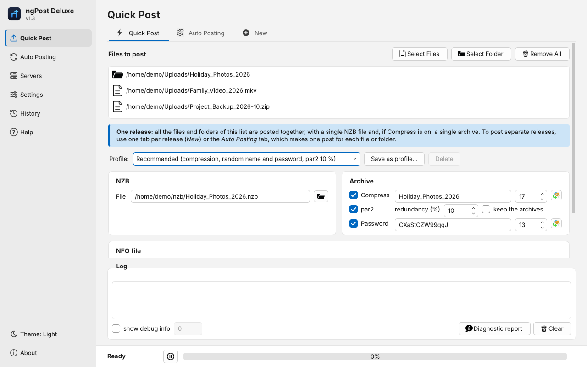
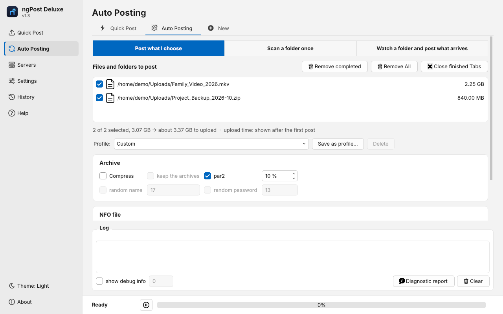
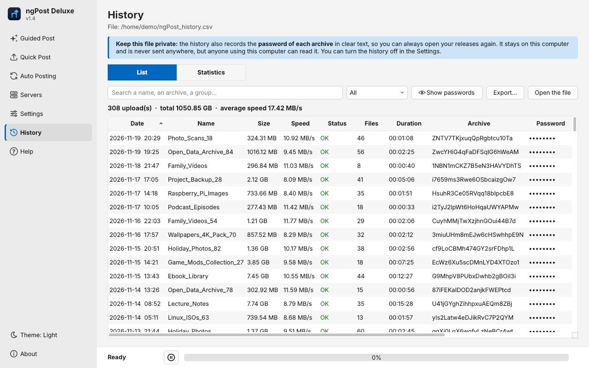
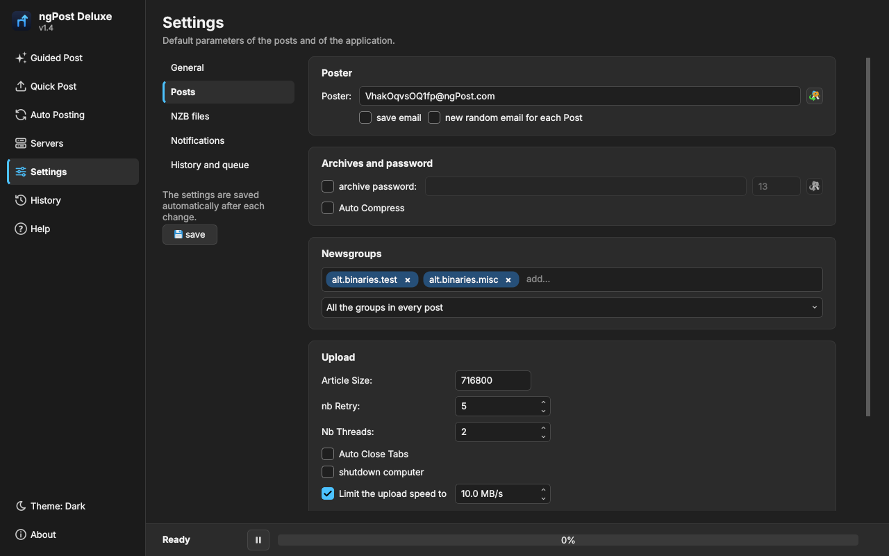
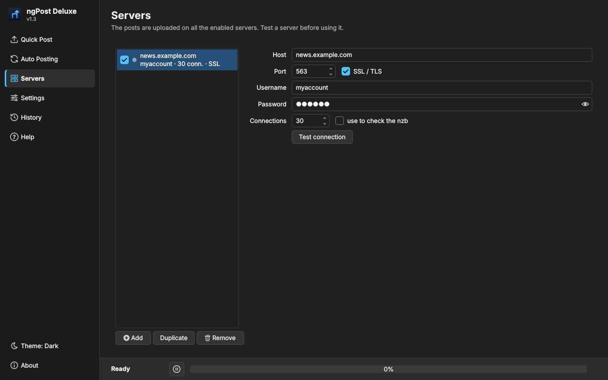

# ngPost Deluxe

[English](README.md) | [Français](README_FR.md) | [Deutsch](README_DE.md) | **Italiano** | [Español](README_ES.md) | [Nederlands](README_NL.md) | [Português](README_PT.md) | [中文](README_ZH.md)

**Un poster Usenet veloce, gratuito e moderno per Windows, Linux e Docker.**<br/>
Comprimi, aggiungi i par2, offusca e posta i tuoi file da un'interfaccia pulita (temi chiaro e scuro) o da riga di comando.

[](https://github.com/thenormal/ngPost-Deluxe/releases/latest)
[](https://github.com/thenormal/ngPost-Deluxe/actions/workflows/build-windows.yml)
[](https://github.com/thenormal/ngPost-Deluxe/actions/workflows/tests.yml)
[](https://github.com/thenormal/ngPost-Deluxe/actions/workflows/docker.yml)


[](LICENSE)

[](https://github.com/thenormal/ngPost-Deluxe/releases/latest)

**ngPost Deluxe** è una versione rivista e ridisegnata del famoso uploader Usenet **ngPost**.<br/>
È un fork di [mbruel/ngPost](https://github.com/mbruel/ngPost) (v4.16, licenza GPL v3). Il merito del programma originale va al suo autore, Matthieu Bruel.<br/>

### Per iniziare
| Installer per Windows | Windows portatile | Docker / Unraid |
|---|---|---|
| Scarica `ngPostDeluxe-v…-win64-setup.exe` (o `win32`) dalla pagina [Releases](https://github.com/thenormal/ngPost-Deluxe/releases/latest). 7-Zip è incluso. | Decomprimi `ngPostDeluxe-v…-win64.zip` (o `win32`) dove vuoi e avvia `ngPostDeluxe.exe`. Le impostazioni sono nel file `ngPost.conf` accanto al programma. | Immagine `ghcr.io/thenormal/ngpost-deluxe` con un template per Unraid. Vedi [docker/README.md](docker/README.md). |

> Windows può mostrare "Il PC è stato protetto da Windows" perché l'installer non è firmato digitalmente: clicca su **Ulteriori informazioni**, poi su **Esegui comunque**.

### Avvio rapido
1. Installa e avvia ngPost Deluxe.
2. Apri **Servers**, aggiungi il tuo server Usenet e premi **Test connection**.
3. Apri **Quick Post** e trascina nella finestra i tuoi file o cartelle. Per pubblicare una release per ogni file o cartella usa **Post automatico**. Il profilo **Consigliato** è un buon punto di partenza (compressione, nome e password casuali, par2 10 %).
4. Premi **Post Files**. Il file NZB viene scritto nella cartella scelta nelle impostazioni e ogni upload compare in **History**.

Usi già ngPost? Copia il tuo `ngPost.conf` in `%APPDATA%\ngPost Deluxe` e ritrovi server e impostazioni.

### Screenshot
| Quick Post (tema chiaro) | Post automatico (tema chiaro) |
|---|---|
|  |  |
| **Cronologia** | **Impostazioni (tema scuro)** |
|  |  |
| **Server (tema scuro)** |  |
|  |  |

### Cosa cambia in questo fork

**Interfaccia**
-   **Nuova interfaccia**: barra laterale (Quick Post, Post automatico, Server, Impostazioni, Cronologia), pagine a carte, opzioni avanzate nascoste finché non servono, una nuova icona e una schermata vuota che spiega cosa fare. **Tema chiaro e scuro**, oppure automatico come Windows (chiave `theme`). Imposta la variabile d'ambiente `NGPOST_NO_THEME` per tornare all'aspetto nativo
-   **Interfaccia in italiano**: la GUI/CMD è ora tradotta anche in italiano (era già disponibile in cinese, olandese, inglese, francese, tedesco, portoghese e spagnolo)
-   **ngPost Deluxe v1.0**: nuovo nome e nuova versione (il programma per Windows ora si chiama `ngPostDeluxe.exe`; il file di configurazione non cambia), finestra About ridisegnata, i pulsanti per le donazioni originali sono sostituiti da un pulsante **Ko-fi** per questo fork (nella finestra About e nelle Impostazioni)
-   **Nuova sezione Server**: elenco dei server con pallino di stato e casella attivo/disattivo, scheda di dettaglio (password visibile a richiesta) e pulsante **Prova connessione** che verifica l'accesso. Modificare i server durante un upload non può più mandare in crash ngPost
-   **Scheda Auto Posting**: nuovi pulsanti **Rimuovi completati**, **Rimuovi tutto** e **Chiudi le schede terminate**
-   **Pagina Cronologia**: ogni upload viene registrato (`ngPost_history.csv` accanto alla configurazione, oppure `POST_HISTORY`) con stato, numero di file e durata. La pagina li elenca con ricerca, filtro per periodo, totali, password nascoste finché non le chiedi, copia, esportazione e cartella dell'NZB. Attenzione: il file contiene le password degli archivi in chiaro
-   **Quick Post**: una nota ricorda che tutti gli elementi dell'elenco vengono postati come un'unica release (un NZB, un archivio)

**Velocità**
-   **ParPar** (un generatore di par2 molto più veloce) è incluso per Windows a 64 bit (v0.4.6, pubblico dominio) e usato automaticamente quando `parpar.exe` si trova nella cartella di ngPost. par2cmdline a 64 bit è stato tolto dal pacchetto, quello a 32 bit resta per Windows a 32 bit
-   **Compressione più veloce su Windows**: l'output di 7-Zip / rar ora viene letto man mano che arriva (un post da 115 MB aspettava 200 s, ora 1 s)

**Pacchetti Windows e Docker**
-   **ngPost Deluxe v1.1**: **immagine Docker** della versione a riga di comando (controlla una cartella e posta tutto quello che ci arriva, con un template per **Unraid**), il pulsante Post è centrato in Quick Post e Auto Posting, icone dei tab e tab finiti leggibili nel tema scuro
-   **Installer per Windows** (64 bit e 32 bit, con **7-Zip incluso**) e pacchetti ZIP portatili, creati automaticamente su GitHub e pubblicati nelle Releases (`ngPostDeluxe.exe`)
-   **Windows**: la finestra della console si chiude da sola quando ngPost viene avviato con un doppio clic; il pacchetto include OpenSSL 1.1.1w (ultima versione supportata da Qt 5)

**Affidabilità e comodità (v1.2)**
-   **Articoli falliti**: un articolo che fallisce viene ritentato su un altro server e in un secondo giro; il pulsante **Repost missing Articles** ripubblica solo quelli mancanti e corregge l'NZB; i file originali vengono conservati quando ci sono articoli falliti
-   **Password sbagliata**: il post si ferma, con un messaggio chiaro, quando il server rifiuta il login su tutte le connessioni
-   **Coda**: i post non finiti vengono salvati e riproposti al prossimo avvio (`--resume_queue` da riga di comando)
-   **Avanzamento e log**: barra di avanzamento con la fase, il tempo rimanente e i colori; log colorato con la durata di ogni fase; misure di latenza nel report diagnostico
-   **Newsgroup**: un riquadro con le "chips", suggerimenti e controlli, e un menu per scegliere dove vanno i post quando ci sono più gruppi
-   Pagina **Help** nel programma, guida per Docker dietro una VPN (gluetun) e test automatici della pubblicazione nella CI

**Più facile da usare (v1.3)**
-   **Post automatico, ridisegnato**: tre scelte chiare (pubblica quello che scelgo, scansiona una cartella una volta, controlla una cartella e pubblica quello che arriva), anteprima di ciò che verrà pubblicato con le dimensioni, stato del controllo della cartella sempre visibile (cartella, post di oggi, pulsante pausa) e scelta di cosa fare dei file dopo il post: niente (predefinito), spostarli in una cartella "Posted" o eliminarli
-   **Profili**: un profilo "Consigliato" già pronto (compressione, nome e password casuali, par2 10 %) e i tuoi profili, salvati dal menu di Quick Post e Post automatico
-   **Controlli prima di pubblicare**: una finestra in parole semplici con la correzione in un clic (nessun server o gruppo, cartelle senza compressione, rar / 7z o par2 non trovati, password vuota, cartella NZB non scrivibile...)
-   **Già pubblicato?** Un avviso elenca gli elementi già presenti nella cronologia, con una casella "Pubblica di nuovo", invece di una domanda per ogni post
-   **File NFO** scritto accanto all'NZB (pubblicabile insieme ai file, con la password se vuoi) e informazioni sul video con MediaInfo: durata, video, audio e sottotitoli
-   **Notifiche** quando i post sono finiti o falliscono: notifica di sistema, Discord, Telegram o un webhook, un messaggio alla fine o uno per ogni post
-   **Aiuto al primo avvio**: una barra dice cosa manca (server, newsgroup) con un pulsante per la pagina giusta; le **Impostazioni** sono ora in cinque categorie
-   **Avviso di nuova versione**: una volta al giorno il programma chiede a GitHub l'ultima versione e mostra nella barra laterale un pulsante "Versione X disponibile" (non scarica nulla; si disattiva nelle Impostazioni)
-   **Aiuto in 8 lingue**, un pulsante **Feedback** nella finestra About (apre una nuova segnalazione su GitHub già compilata) e le notifiche nel rapporto diagnostico
-   **Finestre piccole**: Quick Post e Post automatico scorrono invece di schiacciare le carte una sull'altra
-   Il disinstallatore chiede se eliminare anche impostazioni e cronologia (predefinito: conservarle)

**In arrivo nella 1.4 (non ancora rilasciata)**
-   **Post guidato**: una procedura guidata nella barra laterale che chiede cosa vuoi fare (una release, ogni elemento, scansione di una cartella, monitoraggio di una cartella), cosa postare, le opzioni e dove, poi prepara il post con gli stessi controlli di Quick Post e Post automatico. Ricorda le ultime scelte e può avviare più post insieme
-   **Statistiche** (pagina Cronologia, selettore Elenco / Statistiche): totali e grafici per il periodo scelto (oggi, 7 giorni, 30 giorni, 12 mesi, tutto): dati postati, velocità, risultati, giorni e ore più attivi, newsgroup, server, come sono stati avviati i post e opzioni usate, più le classifiche. Esportazione in documento PDF, pagina web, file CSV o immagini PNG dei grafici
-   **Cronologia** registra più informazioni: i server usati, le opzioni (compressione, password, par2), come è stato avviato il post e la dimensione esatta. Le vecchie cronologie restano valide
-   **Quick Post**: un profilo con nome casuale ora sostituisce il nome preso dal primo file
-   **Limite di velocità**: una velocità massima di upload in MB/s per tutte le connessioni e tutti i post insieme (Impostazioni, Post, Upload; `--max_speed` da riga di comando), così il resto della connessione resta utilizzabile. Si può cambiare mentre si posta

**Sicurezza e correzioni**
-   **Correzione di sicurezza**: possibile overflow dell'heap nel buffer di codifica yEnc (con certi dati l'output poteva essere più grande del buffer)
-   **Correzione yEnc**: uno spazio o un tab a fine riga ora viene protetto correttamente (alcuni server lo eliminavano, corrompendo i dati)
-   **Password più sicure**: le password e i nomi degli archivi generati usano il generatore casuale crittografico del sistema operativo (Qt >= 5.10) invece di `std::rand()`
-   **Password dell'archivio fuori dalla riga di comando**: 7-Zip la riceve sullo standard input e rar tramite la variabile d'ambiente `RAR`, quindi non è più visibile nell'elenco dei processi

**Impostazioni e strumenti**
-   **NZB_POST_CMD**: i segnaposto possono contenere spazi (un percorso come `C:\Le mie cartelle\file.nzb` resta UN SOLO argomento) e il comando viene avviato in background (ngPost non lo aspetta più, quindi il suo codice di uscita non viene più registrato)
-   **RAR_EXTRA e PAR2_ARGS**: analizzati rispettando le virgolette. 7-Zip viene riconosciuto dal nome del programma e non dall'intero percorso
-   **Nuovo README**: riscritto per questo fork e disponibile in 8 lingue (inglese, francese, tedesco, italiano, spagnolo, olandese, portoghese, cinese)
-   **Salvataggio automatico**: ogni modifica delle impostazioni viene salvata da sola (il file precedente resta come `ngPost.conf.bak`)
-   **Diagnostica**: ngPost registra durata e velocità di ogni fase (compressione, par2, upload), gli errori e i blocchi, e il pulsante **Report diagnostico** salva un report per analizzare un problema. Password, nomi utente e nomi dei file vengono mascherati, nulla viene inviato

Gli installer e i pacchetti portatili per Windows e l'immagine Docker sono nelle [Releases](https://github.com/thenormal/ngPost-Deluxe/releases/latest). Sugli altri sistemi va compilato dai sorgenti (vedi sotto).<br/>

### Funzioni principali
-   **Poster Usenet da riga di comando e con una bella interfaccia grafica** per file binari, sviluppato in **C++11/Qt5**
-   è progettato per essere **il più veloce possibile** e offrire TUTTE le funzioni principali **per postare dati in modo semplice e sicuro**.
-   può **comprimere** (con il tuo programma rar esterno) e **generare i par2** prima di postare!
-   ha una **coda di invio** per preparare più post (soprattutto nell'interfaccia grafica con le schede).
-   **prepara il post successivo mentre carica quello attuale** (compressione + generazione dei par2)
-   può **automatizzare i post** **scansionando cartelle** e postando ogni file/cartella singolarmente dopo averli compressi (con un eventuale nome d'archivio e password casuali) e aver generato i par2!
-   può **monitorare cartelle e postare ogni nuovo file/cartella** singolarmente dopo averli compressi.
-   può **eliminare automaticamente file/cartelle dopo il post** (solo con il monitoraggio nell'interfaccia grafica e con --auto e --monitor insieme da riga di comando)
-   può **eseguire un COMANDO o uno script dopo ogni post** (vedi NZB_POST_CMD nel file di configurazione)
-   può **spegnere il computer** quando tutti i post sono finiti
-   **profili** di opzioni, **file NFO** con le informazioni sul video (MediaInfo), **controlli prima di pubblicare**, avviso per ciò che è già nella cronologia e **notifiche** (sistema, Discord, Telegram, webhook)
-   è **tradotto in cinese, olandese, inglese, francese, tedesco, italiano, portoghese e spagnolo**.

### Parole chiave di configurazione modificate in questo fork
Il file di configurazione funziona come nel progetto originale (predefinito: **~/.ngPost** su Linux e Mac, **ngPost.conf** nella cartella di installazione su Windows). Qui sono elencate solo le parole chiave il cui comportamento è cambiato:

- **NZB_POST_CMD**: comando eseguito dopo ogni post. I segnaposto possono contenere spazi e il comando viene avviato in background (il suo codice di uscita non viene registrato)
- **RAR_EXTRA**: per personalizzare il comando rar (non serve indicare 'a', '-idp' o '-r'). Non serve per 7-zip, tranne se vuoi cambiare il livello di compressione.
- **PAR2_PATH**: per cambiare il generatore di par2 e poter usare [Parpar](https://github.com/animetosho/ParPar) o [Multipar](http://hp.vector.co.jp/authors/VA021385/). (par2cmdline è il generatore incluso di default, ParPar viene usato automaticamente su Windows a 64 bit se `parpar.exe` è nella cartella di ngPost)
- **PAR2_ARGS**: per personalizzare il comando par2, soprattutto se scegli un programma diverso dal par2cmdline predefinito
- **theme**: tema dell'interfaccia, `AUTO` (come Windows), `LIGHT` o `DARK`
- **history**: `ON` (predefinito) o `OFF`, cronologia degli upload mostrata nella pagina Cronologia. Senza **POST_HISTORY** il file è `ngPost_history.csv` accanto alla configurazione. In fondo a ogni riga ci sono nuove colonne: stato, numero di file, durata e file NZB; dalla v1.4 anche i server, le opzioni, come è stato avviato il post e la dimensione esatta
- **move_posted**: cartella in cui il Post automatico sposta ogni file o cartella dopo la pubblicazione (accanto a ogni elemento viene creata una cartella con un nome come `Posted`, un percorso completo viene usato così com'è); anche `--move_posted`
- **warn_duplicates**: `ON` (predefinito) oppure `OFF`, avvisa (GUI) o salta (riga di comando) ciò che è già nella cronologia; `--allow_repost` lo pubblica comunque
- **limit_speed** (`ON` / `OFF`) e **max_speed** (MB/s): velocità massima di upload per tutte le connessioni insieme, anche `--max_speed`; la sola `max_speed` attiva il limite (comodo con Docker)
- **gen_nfo**, **nfo_in_post**, **nfo_password**, **nfo_media** (`ON` / `OFF`), **mediainfo_path** e **nfo_text**: file NFO scritto accanto all'NZB, pubblicato con i file, con la password, con le informazioni di MediaInfo; percorso di MediaInfo; testo libero aggiunto in fondo
- **profile**: i profili di opzioni salvati dalla GUI, una riga per ciascuno (meglio gestirli dal menu di Quick Post e Post automatico che a mano)
- **check_updates**: `ON` (predefinito) oppure `OFF`, una volta al giorno la GUI cerca una nuova versione su GitHub (la riga di comando e Docker non lo fanno mai)
- **notify_discord**, **notify_telegram_token**, **notify_telegram_chat**, **notify_webhook** e **notify_when** (`all_done` o `each`): notifiche quando i post sono finiti. Tratta gli indirizzi e il token come password

### Come compilare
#### Linux
Dipendenze (Ubuntu / Debian):
```
sudo apt install build-essential qtbase5-dev qt5-qmake libssl-dev
```
Compilare la versione grafica, oppure solo quella a riga di comando (non servono le librerie grafiche di Qt):
```
# GUI
cd src && qmake ngPost.pro && make -j$(nproc)

# command line only, in its own folder
mkdir build-cmd && cd build-cmd && qmake ../src/ngPost_cmd.pro && make -j$(nproc)
```
L'eseguibile **ngPost** viene creato nella cartella in cui hai compilato: copialo in una cartella del PATH.

#### Windows
Installa [Qt 5.15](https://www.qt.io/download) con MinGW, poi apri `src/ngPost.pro` in Qt Creator, oppure da un prompt dei comandi di Qt: `mkdir build && cd build && qmake ../src/ngPost.pro CONFIG+=release && mingw32-make`. Il programma si chiama `ngPostDeluxe.exe`. L'installer si crea con [Inno Setup](https://jrsoftware.org/isinfo.php) (`installer/ngPostDeluxe.iss`); tutti i passaggi dei pacchetti ufficiali sono in `.github/workflows/build-windows.yml`.

#### Docker
Versione a riga di comando in un container (vedi [docker/README.md](docker/README.md)):
```
docker build -t ngpost-deluxe .
```

#### Altri sistemi
Essendo scritto in C++/Qt, si può compilare ed eseguire su qualsiasi sistema (macOS, Android...): il modo più semplice è [installare Qt](https://www.qt.io/download) e aprire `src/ngPost.pro` in Qt Creator.

### Documentazione completa
Le opzioni da riga di comando, l'elenco completo delle parole chiave di configurazione e le guide di installazione sono quelle del progetto originale: vedi il [README di ngPost](https://github.com/mbruel/ngPost#readme). Le sue guide di installazione si riferiscono ai binari originali, non a questo fork.

### FAQ

**Windows dice "Il PC è stato protetto da Windows". È sicuro?**<br/>
L'installer non è firmato digitalmente (la firma costa), quindi SmartScreen avvisa per qualsiasi programma sconosciuto. Clicca su **Ulteriori informazioni**, poi su **Esegui comunque**. Il programma è open source e i pacchetti vengono compilati automaticamente da questo repository.

**Dove sono le mie impostazioni e la cronologia?**<br/>
Con l'installer: in `%APPDATA%\ngPost Deluxe` (`ngPost.conf` e `ngPost_history.csv`). Con la versione portatile: `ngPost.conf` accanto al programma. Se c'è un `ngPost.conf` accanto a `ngPostDeluxe.exe`, viene usato al posto di quello in `%APPDATA%`. La cronologia si può spostare con `POST_HISTORY`.

**Come mantengo le impostazioni dell'ngPost originale?**<br/>
Chiudi ngPost Deluxe, copia il vecchio `ngPost.conf` in `%APPDATA%\ngPost Deluxe` e, se contiene una riga `PAR2_PATH` che punta a una vecchia cartella, cancellala (il programma userà il suo ParPar). Anche il vecchio `ngPost_history.csv` viene letto: copialo accanto alla configurazione, oppure mantieni il percorso in `POST_HISTORY`.

**Qualcosa non funziona (compressione, par2, upload…). Cosa posso fare?**<br/>
Premi **Diagnostic report** nel log e allega il file a una [issue](https://github.com/thenormal/ngPost-Deluxe/issues). Password, nomi utente e nomi dei file sono mascherati e non viene inviato nulla.

**Devo installare 7-Zip o rar?**<br/>
No: 7-Zip è incluso nell'installer e nel pacchetto portatile. Nelle impostazioni puoi comunque scegliere un altro 7-Zip o WinRAR.

**La cronologia è privata?**<br/>
Contiene le password degli archivi in chiaro: tieni privati `ngPost_history.csv` e `ngPost.conf` (che contiene il login del server) e non allegarli a una issue pubblica.

### Licenza
[**ngPost**](https://github.com/mbruel/ngPost) è rilasciato con licenza **GPL v3** (vedi [LICENSE](LICENSE)). Copyright (C) 2020 Matthieu Bruel. ngPost Deluxe è un fork mantenuto da [thenormal](https://github.com/thenormal).

### Domande / Problemi / Richieste
- per domande su questo fork puoi contattare il suo manutentore su GitHub: [thenormal](https://github.com/thenormal)
- per il programma originale fai riferimento al [progetto originale](https://github.com/mbruel/ngPost) e al suo autore Matthieu Bruel

### Lingue supportate
Per ora ngPost è tradotto in cinese, olandese, inglese, francese, tedesco, italiano, portoghese e spagnolo (la traduzione italiana è stata aggiunta in questo fork).<br/>
Se vuoi tradurre ngPost nella tua lingua è facile (c'è una comoda interfaccia: QtLinguist). I file di traduzione sono nella cartella **src/lang**.

### Ringraziamenti
- Matthieu Bruel (mbruel) per aver creato ngPost e averlo pubblicato con licenza GPL v3
- Uukrull per i suoi test intensivi e i suggerimenti e per aver costruito tutti i pacchetti MacOS.
- awsms per i suoi test su un vero server con connessione da 10 Gb/s che hanno aiutato a migliorare la velocità di upload di ngPost e il supporto al multi-threading
- animetosho per aver sviluppato ParPar, il generatore di par2 più veloce di sempre!
- demanuel per lo sviluppo di NewsUP, che è stato il mio primo poster
- noobcoder1983, tensai e poi yuppie per la traduzione tedesca
- tiriclote per la traduzione spagnola
- hunesco per la traduzione portoghese
- Peng per la traduzione cinese
- tutti gli utenti di ngPost ;)

### Sostenere questo fork
ngPost Deluxe è gratuito. Se ti è utile, puoi sostenerne lo sviluppo su Ko-fi:<br/>
[](https://ko-fi.com/thenormal)

### Sostenere l'autore originale
ngPost è stato creato da Matthieu Bruel. Se usi l'app e vuoi contribuire allo sforzo, fallo sul [progetto originale](https://github.com/mbruel/ngPost).
