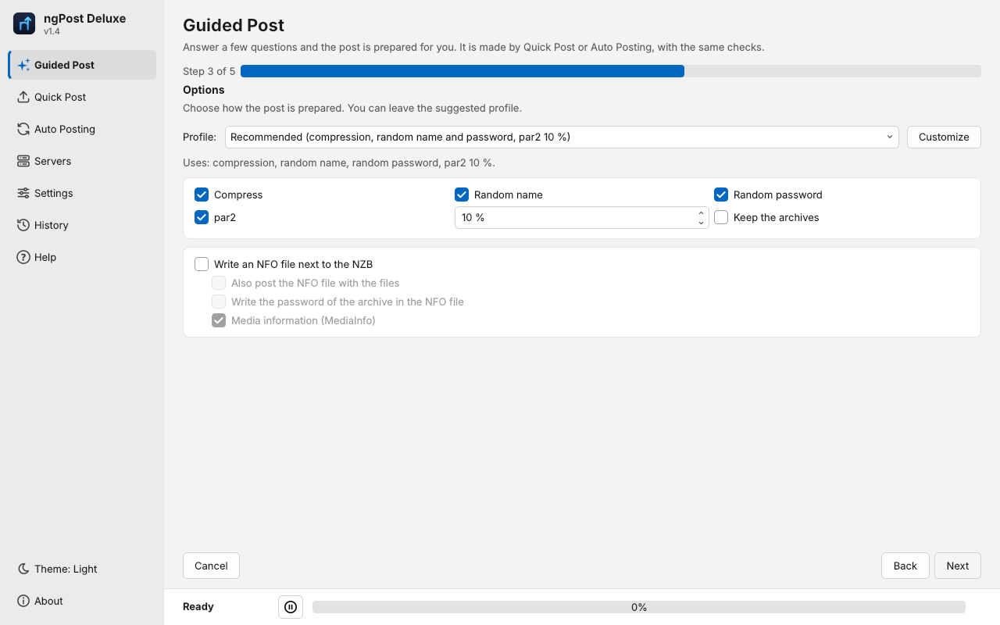
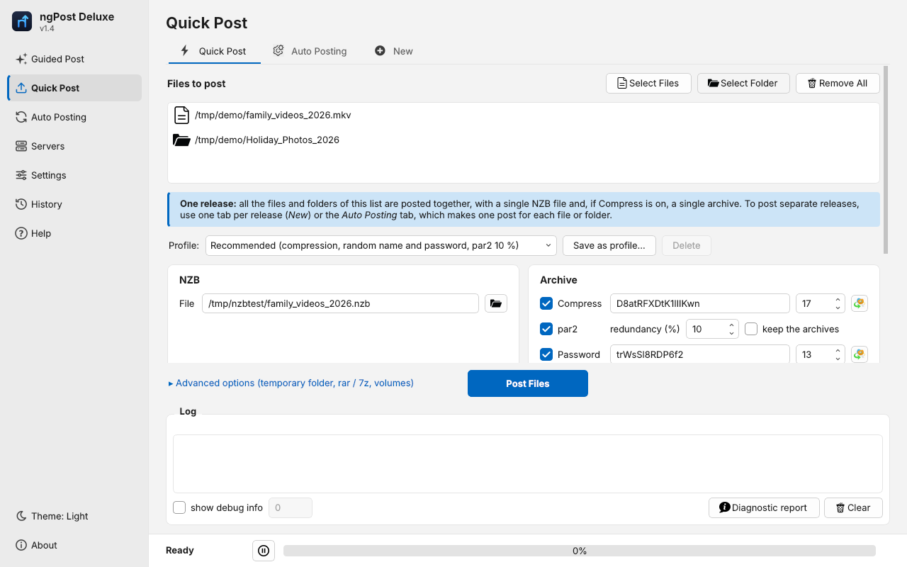
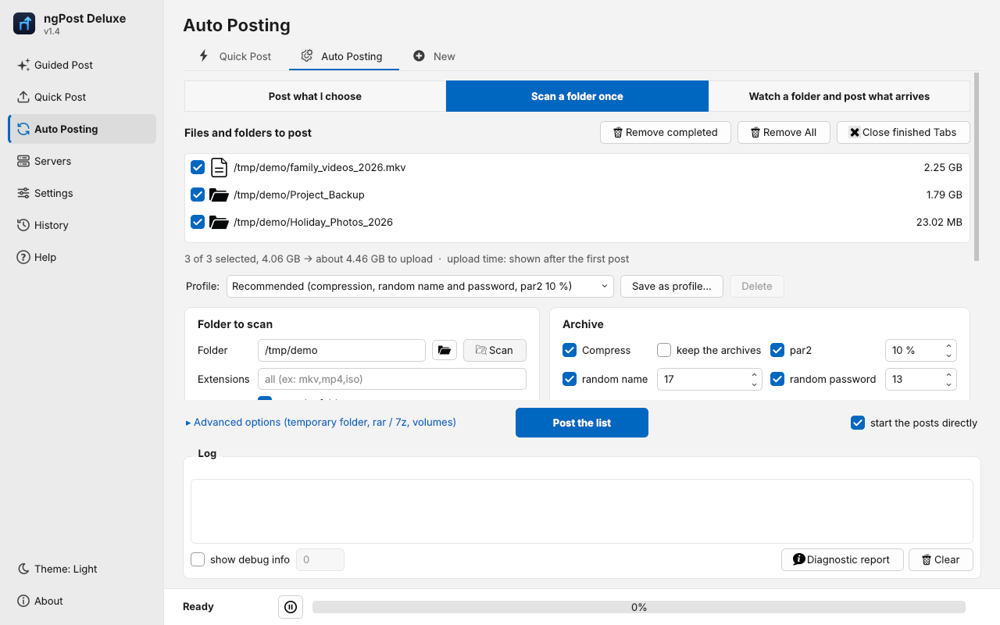
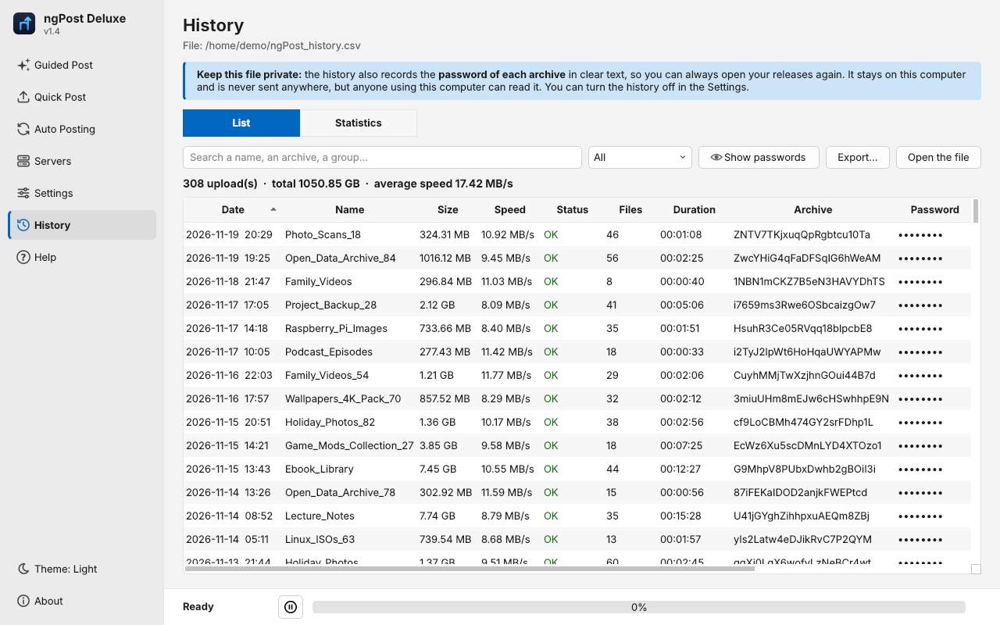
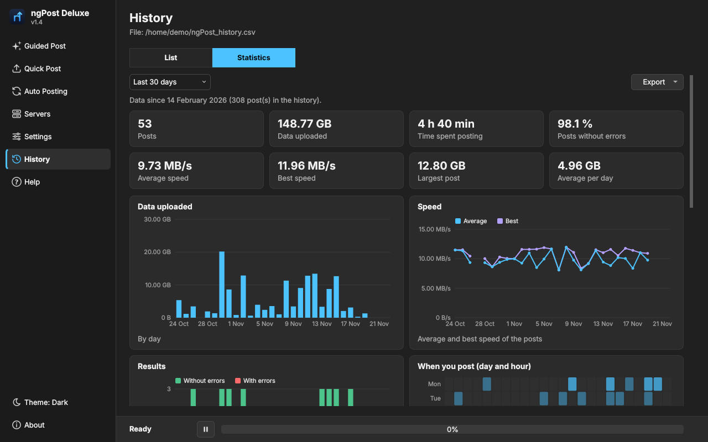
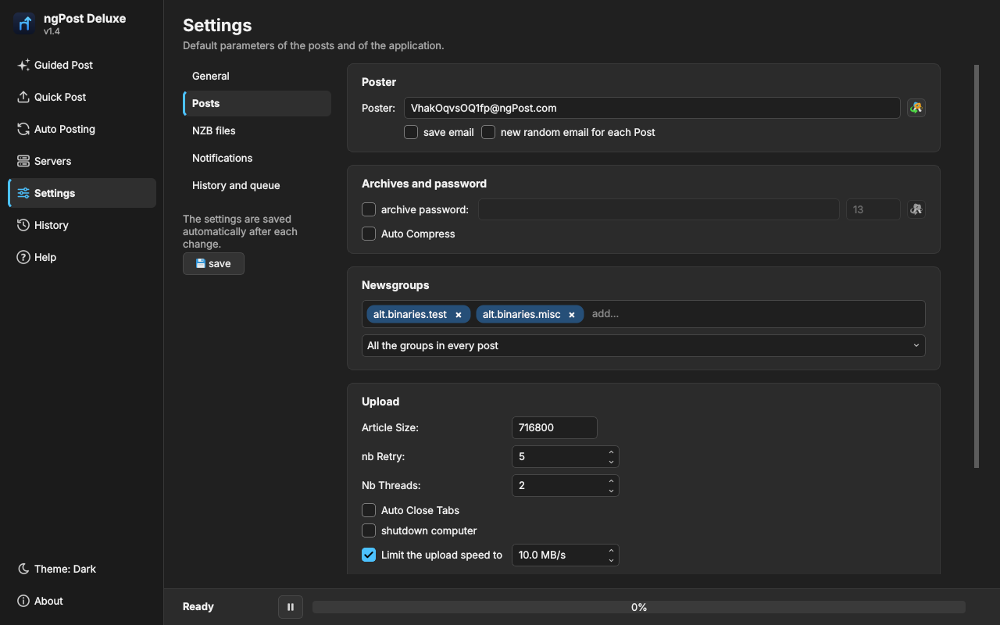
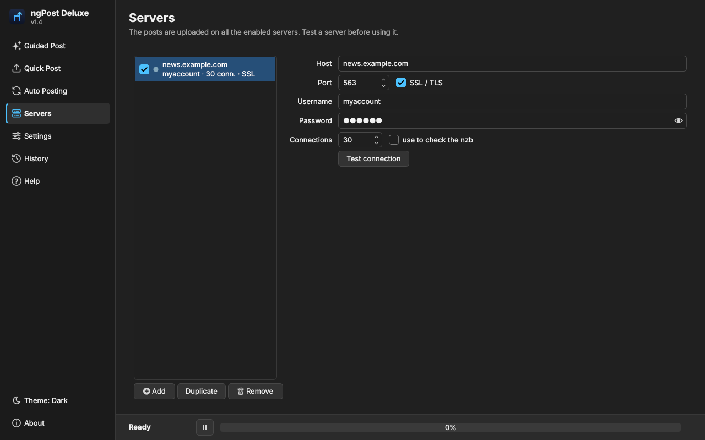

# ngPost Deluxe

[English](README.md) | [Français](README_FR.md) | [Deutsch](README_DE.md) | [Italiano](README_IT.md) | [Español](README_ES.md) | [Nederlands](README_NL.md) | [Português](README_PT.md) | **中文**

**适用于 Windows、Linux 和 Docker 的快速、免费、现代的 Usenet 上传工具。**<br/>
通过简洁的界面（浅色和深色主题）或命令行，压缩、添加 par2、混淆并发布你的文件。

[](https://github.com/thenormal/ngPost-Deluxe/releases/latest)
[](https://github.com/thenormal/ngPost-Deluxe/actions/workflows/build-windows.yml)
[](https://github.com/thenormal/ngPost-Deluxe/actions/workflows/tests.yml)
[](https://github.com/thenormal/ngPost-Deluxe/actions/workflows/docker.yml)


[](LICENSE)

[](https://github.com/thenormal/ngPost-Deluxe/releases/latest)

**ngPost Deluxe** 是著名 Usenet 上传工具 **ngPost** 的重新审视与重新设计版本。<br/>
它是 [mbruel/ngPost](https://github.com/mbruel/ngPost)（v4.16，GPL v3 许可证）的分支（fork）。原始程序的全部功劳归于其作者 Matthieu Bruel。<br/>

### 开始使用
| Windows 安装程序 | Windows 便携版 | Docker / Unraid |
|---|---|---|
| 从 [Releases](https://github.com/thenormal/ngPost-Deluxe/releases/latest) 页面下载 `ngPostDeluxe-v…-win64-setup.exe`（或 `win32`）。已包含 7-Zip。 | 将 `ngPostDeluxe-v…-win64.zip`（或 `win32`）解压到任意位置，启动 `ngPostDeluxe.exe`。设置保存在程序旁边的 `ngPost.conf` 中。 | 镜像 `ghcr.io/thenormal/ngpost-deluxe`，附带 Unraid 模板。见 [docker/README.md](docker/README.md)。 |

> 由于安装程序没有数字签名，Windows 可能会显示“Windows 已保护你的电脑”：点击**更多信息**，然后点击**仍要运行**。

### 快速开始
1. 安装并启动 ngPost Deluxe。
2. 打开 **Servers**，添加你的 Usenet 服务器并点击 **Test connection**。
3. 打开 **Quick Post**，把文件或文件夹拖进窗口。 如果想为每个文件或文件夹分别发布一个 release，请使用**自动发布**。**推荐**方案是个不错的起点（压缩、随机名称和密码、par2 10 %）。
4. 点击 **Post Files**。NZB 文件会写入在设置中选择的文件夹，每次上传都会显示在 **History** 中。

> 初次使用 ngPost Deluxe？请试试侧边栏中的 **引导发布**：它会问几个问题并为您准备好发布。

已经在使用 ngPost？把你的 `ngPost.conf` 复制到 `%APPDATA%\ngPost Deluxe`，你的服务器和设置就都在了。

### 截图

| 引导发布（浅色主题） | Quick Post（浅色主题） |
|---|---|
|  |  |
| **自动发布（浅色主题）** | **历史记录** |
|  |  |
| **统计（深色主题）** | **设置（深色主题）** |
|  |  |
| **服务器（深色主题）** |  |
|  |  |

### 本分支的不同之处

**易于使用**
-   **引导发布**：侧边栏中的向导，询问您想做什么（一个 release、每个项目、扫描文件夹、监视文件夹）、要发布什么、选项以及发布位置，然后用与 Quick Post 和自动发布相同的检查来准备发布。它会记住您上次的选择，并可一起启动多个发布
-   **重新设计的自动发布**：三个清晰的选择（发布我选的、扫描一次文件夹、监视文件夹并发布新到的文件），发布前预览内容和大小，文件夹监视状态始终可见（文件夹、今日发布数、暂停按钮），并可选择发布后如何处理文件：不处理（默认）、移动到“Posted”文件夹或删除
-   **配置方案**：现成的“推荐”方案（压缩、随机名称和密码、par2 10 %），以及你自己的方案，可从 Quick Post 和自动发布的菜单中保存
-   **发布前检查**：用简明文字显示的窗口，一键修复（没有服务器或群组、文件夹未压缩、找不到 rar / 7z 或 par2、密码为空、NZB 文件夹不可写...）
-   **记住您的选择**：Quick Post 和自动发布会为下次启动保留上次的选项和所选方案，发布按钮始终固定显示在滚动页面下方
-   **首次启动帮助**：一个提示条会说明缺少什么（服务器、新闻组）并提供前往相应页面的按钮；**设置**现在分为五个类别
-   **新闻组**: 带有 "chips", 建议和检查的输入框, 以及在有多个新闻组时选择发布位置的菜单
-   **全新界面**：侧边栏（快速发布、自动发布、服务器、设置、历史记录），卡片式页面，高级选项在需要时才显示，新图标，以及说明操作方法的空白页面。**浅色和深色主题**，或跟随 Windows 自动切换（`theme` 键）。设置环境变量 `NGPOST_NO_THEME` 可恢复原生外观
-   **全新的服务器区域**：服务器列表带状态指示点和启用/禁用复选框，详情表单（密码可按需显示），以及检查登录的 **测试连接** 按钮。发布过程中修改服务器不会再导致 ngPost 崩溃

**信息丰富**
-   **统计**（历史记录页面，列表 / 统计切换）：所选时间段（今天、7 天、30 天、12 个月、全部）的总计和图表：发布的数据量、速度、结果、最活跃的日期和时段、新闻组、服务器、发布的启动方式和使用的选项，以及排行榜。可导出为 PDF 文档、网页、CSV 文件或图表的 PNG 图片
-   **历史记录页面**：每次上传都会被记录（配置文件旁边的 `ngPost_history.csv`，或 `POST_HISTORY`），包括状态、文件数和耗时。该页面提供搜索、按时间段筛选、汇总、默认隐藏的密码、复制、导出以及打开 NZB 所在文件夹。注意：该文件以明文保存压缩包密码
-   **通知**：发布完成或失败时发送：系统通知、Discord、Telegram 或 webhook，可在全部完成时发一条，或每个发布发一条
-   **NFO 文件**写在 NZB 旁边（可与文件一起发布，也可按需包含密码），以及用 MediaInfo 获取的媒体信息：时长、视频、音频和字幕
-   **已发布过？** 警告会列出历史记录中已有的项目，并提供“再次发布”复选框，而不是每个发布问一次
-   **诊断**：ngPost 会记录每个阶段（压缩、par2、上传）的耗时和速度、错误和界面卡顿，**诊断报告** 按钮可保存报告用于分析问题。密码、用户名和文件名都会被隐藏，不会发送任何内容

**可靠**
-   **失败的文章**: 失败的文章会先在另一台服务器上重试, 然后进行第二轮; 按钮 **Repost missing Articles** 只重新发布缺失的文章并修正 NZB; 有文章失败时会保留原始文件
-   **队列**: 未完成的发布会被保存, 并在下次启动时再次提供 (命令行使用 `--resume_queue`)
-   **密码错误**: 当服务器在所有连接上都拒绝登录时, 发布会停止并给出清晰的提示
-   **更清晰的问题提示**：临时文件夹被同步（OneDrive 等）时发出警告，源文件读取缓慢时给出提示，压缩前被移动的文件或文件夹会给出明确的错误并指出名称（7-Zip 不再在所有磁盘上搜索它）

**快速且可控**
-   为 64 位 Windows 附带 **ParPar**（快得多的 par2 生成器，v0.4.6，公有领域），当 ngPost 文件夹中存在 `parpar.exe` 时自动使用。已从软件包中移除 64 位 par2cmdline，32 位版本仍保留给 32 位 Windows
-   **Windows 上压缩更快**：现在会随时读取 7-Zip / rar 的输出（115 MB 的帖子以前要等 200 秒，现在 1 秒）
-   **速度限制**：所有连接和所有发布合计的最大上传速度，单位 MB/s（设置、发布、上传；命令行使用 `--max_speed`），让您的网络其余部分仍可正常使用。发布过程中也可以更改

**安全**
-   **安全修复**：修复 yEnc 编码缓冲区中可能的堆溢出（对于某些数据，输出可能超出缓冲区大小）
-   **压缩包密码不再出现在命令行中**：7-Zip 通过标准输入接收密码，rar 通过 `RAR` 环境变量接收，因此进程列表中不再可见

**安装包与语言**
-   命令行版本的 **Docker 镜像**：监视一个文件夹并发布其中新增的所有内容，附带 **Unraid** 模板以及在 VPN 之后使用的指南
-   **Windows 安装程序**（64 位和 32 位，**内置 7-Zip**）和便携 ZIP 软件包，在 GitHub 上自动构建并发布在 Releases 中（`ngPostDeluxe.exe`）
-   **新版本提示**：程序每天向 GitHub 询问一次最新版本，并在侧边栏显示“有新版本 X”按钮（不会下载任何内容；可在设置中关闭）
-   **8 种语言的帮助**，关于窗口中的**反馈**按钮（打开已填好的 GitHub 新 issue），以及诊断报告中的通知信息

**设置与工具**
-   **NZB_POST_CMD**：占位符可以包含空格（例如 `C:\我的文件夹\文件.nzb` 这样的路径仍然是同一个参数），并且命令在后台启动（ngPost 不再等待它结束，因此不再记录其退出码）
-   **RAR_EXTRA 和 PAR2_ARGS**：解析时遵循双引号。7-Zip 通过程序名称而不是完整路径来识别
-   **自动保存**：每次修改设置都会自动保存（之前的文件保留为 `ngPost.conf.bak`）

Windows 安装程序、便携包和 Docker 镜像在 [Releases](https://github.com/thenormal/ngPost-Deluxe/releases/latest) 页面。其他系统请从源码编译（见下文）。<br/>

各版本的完整更新列表见[发布说明](https://github.com/thenormal/ngPost-Deluxe/releases)和[路线图](ROADMAP.md)。

### 主要功能
-   面向二进制文件的**命令行 Usenet 上传工具，并带有美观的图形界面**，使用 **C++11/Qt5** 开发
-   它的设计目标是**尽可能快**，并提供所有重要功能，**让数据发布简单又安全**。
-   它可以在发布前**压缩**（使用你的外部 rar 程序）并**生成 par2 文件**！
-   它有**队列**，可以准备多个帖子（主要用于带标签页的图形界面）。
-   它会在**上传当前帖子的同时打包下一个帖子**（压缩 + 生成 par2）
-   它可以**自动化**发布：**扫描文件夹**，将每个文件/文件夹压缩后单独发布（可选随机压缩包名称和密码），并生成 par2！
-   它可以**监视文件夹**，将每个新文件/文件夹压缩后单独发布。
-   它可以在**发布后自动删除文件/文件夹**（仅限图形界面的监视模式，以及命令行中同时使用 --auto 和 --monitor）
-   它可以在每次发布后**执行命令或脚本**（见配置文件中的 NZB_POST_CMD）
-   它可以在所有帖子完成后**关闭计算机**
-   选项**配置方案**、带媒体信息（MediaInfo）的 **NFO 文件**、**发布前检查**、对历史记录中已有内容的警告，以及**通知**（系统、Discord、Telegram、webhook）
-   向导 **引导发布** 和上传**统计**（图表，可导出为 PDF、网页、CSV 或 PNG）
-   它已**翻译为中文、荷兰语、英语、法语、德语、意大利语、葡萄牙语和西班牙语**。

### 本分支中修改过的配置关键字
配置文件的使用方式与原始项目相同（默认：Linux 和 Mac 为 **~/.ngPost**，Windows 为安装文件夹中的 **ngPost.conf**）。这里只列出行为发生变化的关键字：

- **NZB_POST_CMD**：每次发布后执行的命令。占位符可以包含空格，命令在后台运行（不记录其退出码）
- **RAR_EXTRA**：用于自定义 rar 命令（无需指定 'a'、'-idp' 或 '-r'）。7-zip 不需要，除非你想更改压缩级别。
- **PAR2_PATH**：用于更改 par2 生成器，以便使用 [Parpar](https://github.com/animetosho/ParPar) 或 [Multipar](http://hp.vector.co.jp/authors/VA021385/)。（par2cmdline 是默认附带的生成器；在 64 位 Windows 上，如果 ngPost 文件夹中有 `parpar.exe`，则自动使用 ParPar）
- **PAR2_ARGS**：用于自定义 par2 命令，特别是在选择了不同于默认 par2cmdline 的程序时
- **theme**：界面主题，`AUTO`（跟随 Windows）、`LIGHT` 或 `DARK`
- **history**：`ON`（默认）或 `OFF`，上传历史记录显示在历史记录页面。未设置 **POST_HISTORY** 时，文件为配置文件旁边的 `ngPost_history.csv`。每行末尾新增列：状态、文件数、耗时和 NZB 文件；从 v1.4 起还有服务器、选项、发布的启动方式和精确大小
- **move_posted**：自动发布在发布完成后移动每个文件或文件夹的目标文件夹（会在每个项目旁创建名称如 `Posted` 的文件夹，完整路径则原样使用）；也可用 `--move_posted`
- **warn_duplicates**：`ON`（默认）或 `OFF`，对历史记录中已有的内容发出警告（图形界面）或跳过（命令行）；`--allow_repost` 则照常发布
- **limit_speed**（`ON` / `OFF`）和 **max_speed**（MB/s）：所有连接合计的最大上传速度，也可用 `--max_speed`；只设置 `max_speed` 就会开启限制（适合 Docker）
- **gen_nfo**、**nfo_in_post**、**nfo_password**、**nfo_media**（`ON` / `OFF`）、**mediainfo_path** 和 **nfo_text**：在 NZB 旁写入 NFO 文件，随文件一起发布，包含密码，包含 MediaInfo 信息；MediaInfo 的路径；添加在末尾的自由文本
- **profile**：从图形界面保存的选项配置方案，每个方案一行（最好通过 Quick Post 和自动发布的菜单管理，而不是手动编辑）
- **quick_options**、**auto_options**、**quick_profile** 和 **auto_profile**：程序关闭时 Quick Post 和自动发布的选项与方案，由程序自行写入（无需手动编辑）
- **check_updates**：`ON`（默认）或 `OFF`，图形界面每天在 GitHub 上查找一次新版本（命令行和 Docker 从不检查）
- **notify_discord**、**notify_telegram_token**、**notify_telegram_chat**、**notify_webhook** 和 **notify_when**（`all_done` 或 `each`）：发布完成时的通知。请像对待密码一样对待这些地址和令牌

### 编译
#### Linux
依赖（Ubuntu / Debian）：
```
sudo apt install build-essential qtbase5-dev qt5-qmake libssl-dev
```
编译图形界面版本，或只编译命令行版本（不需要 Qt 图形库）：
```
# GUI
cd src && qmake ngPost.pro && make -j$(nproc)

# command line only, in its own folder
mkdir build-cmd && cd build-cmd && qmake ../src/ngPost_cmd.pro && make -j$(nproc)
```
可执行文件 **ngPost** 会生成在你编译的文件夹中：把它复制到 PATH 中的某个文件夹即可。

#### Windows
安装带 MinGW 的 [Qt 5.15](https://www.qt.io/download)，然后在 Qt Creator 中打开 `src/ngPost.pro`，或在 Qt 命令提示符中执行：`mkdir build && cd build && qmake ../src/ngPost.pro CONFIG+=release && mingw32-make`。程序名为 `ngPostDeluxe.exe`。安装程序使用 [Inno Setup](https://jrsoftware.org/isinfo.php) 制作（`installer/ngPostDeluxe.iss`）；正式包的所有步骤都在 `.github/workflows/build-windows.yml` 中。

#### Docker
容器中的命令行版本（见 [docker/README.md](docker/README.md)）：
```
docker build -t ngpost-deluxe .
```

#### 其他系统
由于使用 C++/Qt 编写，它可以在任何系统（macOS、Android……）上编译和运行：最简单的方法是[安装 Qt](https://www.qt.io/download)，并在 Qt Creator 中加载 `src/ngPost.pro`。

### 完整文档
命令行选项、完整的配置关键字列表和安装指南与原始项目相同：请参阅 [ngPost 的 README](https://github.com/mbruel/ngPost#readme)。其中的安装指南针对的是原始二进制文件，而不是本分支。

### 常见问题

**Windows 提示“Windows 已保护你的电脑”，安全吗？**<br/>
安装程序没有数字签名（签名需要付费），所以 SmartScreen 会对任何未知程序发出警告。点击**更多信息**，然后点击**仍要运行**。本程序是开源的，软件包由本仓库自动构建。

**我的设置和历史记录在哪里？**<br/>
使用安装程序时：在 `%APPDATA%\ngPost Deluxe` 中（`ngPost.conf` 和 `ngPost_history.csv`）。便携版：`ngPost.conf` 在程序旁边。如果 `ngPostDeluxe.exe` 旁边有 `ngPost.conf`，则优先使用它，而不是 `%APPDATA%` 中的文件。历史记录可以用 `POST_HISTORY` 移动。

**如何保留原版 ngPost 的设置？**<br/>
关闭 ngPost Deluxe，把旧的 `ngPost.conf` 复制到 `%APPDATA%\ngPost Deluxe`；如果其中有指向旧文件夹的 `PAR2_PATH` 行，请删除该行（程序会使用自带的 ParPar）。旧的 `ngPost_history.csv` 也能读取：把它复制到配置文件旁边，或在 `POST_HISTORY` 中保留其路径。

**有些功能不工作（压缩、par2、上传……），怎么办？**<br/>
在日志中点击 **Diagnostic report**，并把文件附加到一个 [issue](https://github.com/thenormal/ngPost-Deluxe/issues) 中。密码、用户名和文件名都已被屏蔽，不会发送任何数据。

**需要安装 7-Zip 或 rar 吗？**<br/>
不需要：安装程序和便携包都已包含 7-Zip。你仍然可以在设置中选择其他 7-Zip 或 WinRAR。

**历史记录是私密的吗？**<br/>
其中包含明文的压缩包密码：请妥善保管 `ngPost_history.csv` 和 `ngPost.conf`（其中有你的服务器登录信息），不要把它们附加到公开的 issue 中。

### 许可证
[**ngPost**](https://github.com/mbruel/ngPost) 采用 **GPL v3** 许可证发布（见 [LICENSE](LICENSE)）。版权所有 (C) 2020 Matthieu Bruel。ngPost Deluxe 是由 [thenormal](https://github.com/thenormal) 维护的分支。

### 问题 / 故障 / 请求
- 关于本分支的问题，请在 GitHub 上联系维护者：[thenormal](https://github.com/thenormal)
- 关于原始程序，请参阅[原始项目](https://github.com/mbruel/ngPost)及其作者 Matthieu Bruel

### 支持的语言
目前 ngPost 已翻译为中文、荷兰语、英语、法语、德语、意大利语、葡萄牙语和西班牙语（意大利语翻译是在本分支中添加的）。<br/>
如果你想把 ngPost 翻译成你的语言，很容易（有一个方便的图形界面工具：QtLinguist）。翻译文件位于 **src/lang** 文件夹。

### 致谢
- Matthieu Bruel (mbruel)：创建 ngPost 并以 GPL v3 发布
- Uukrull：大量测试、反馈，并构建了所有 MacOS 软件包。
- awsms：在 10 Gb/s 连接的真实服务器上进行测试，帮助提升了 ngPost 的上传速度和多线程支持
- animetosho：开发了史上最快的 par2 生成器 ParPar！
- demanuel：开发了 NewsUP，那是我的第一个上传工具
- noobcoder1983、tensai，以及后来的 yuppie：德语翻译
- tiriclote：西班牙语翻译
- hunesco：葡萄牙语翻译
- Peng：中文翻译
- 所有 ngPost 用户 ;)

### 支持本分支
ngPost Deluxe 是免费的。如果它对你有用，你可以在 Ko-fi 上支持它的开发：<br/>
[](https://ko-fi.com/thenormal)

### 支持原作者
ngPost 由 Matthieu Bruel 创建。如果你使用该应用并希望为这项工作做出贡献，请通过[原始项目](https://github.com/mbruel/ngPost)进行。
